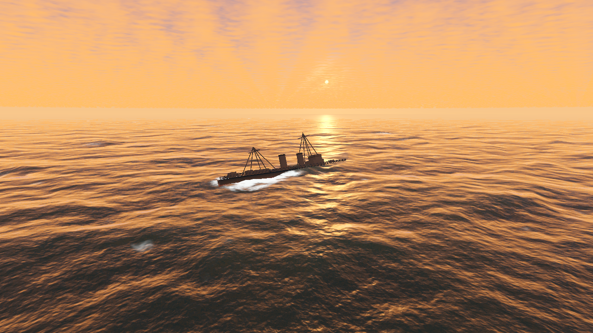

# Ocean Lab

いただいた「Godotでリアルな海」の技術メモをもとに作った、操作できるGodotの再現プロトタイプです。外部アセットのダウンロードやAPIキーなしで起動できます。



上の画像は5段×512²、夕景、穏やかな海、増幅1.6倍での実際のGodot描画です。[昼の通常の海](previews/day.png) / [夕景の通常の海](previews/sunset_rough.png) も保存しています。検証結果は [VALIDATION.md](VALIDATION.md) にまとめています。

## 起動

1. **Godot 4.6以降**で、このフォルダーの `project.godot` をインポートします。
2. レンダラーを **Forward+** にして、**F6ではなくF5** で実行します。
3. 最初はGPUシェーダーのコンパイルと雲のノイズ生成を待ちます。

Linux / macOSでは `./run.sh` でも起動できます。Godotの実行ファイルがPATHにない場合は、エディターから開いてください。Windowsも同じプロジェクトを開けます。OS別の実機確認はLinuxのみです。

高品質は5段×512²。重い場合は画面右の品質設定で256²または128²に変更できます。Forward+が利用できないときは、明示的に **ANALYTIC PREVIEW** と表示される簡易波へ切り替わります。簡易表示はFFTではありません。

## 操作

| 操作 | 動作 |
| --- | --- |
| 右ドラッグ / ホイール | 視点を回す / 距離を変える |
| W / S | 船の目標速度を増減する |
| A / D | 舵を切る |
| 1 / 2 / 3 / 4 | 船尾から / 艦首から / 俯瞰 / 水面近く |
| Space | 波・船を一時停止する |
| Tab | UIを隠す |
| F1 | 通常→法線→泡→タイル→砕波/分散→航跡の診断表示 |
| F12 | `captures/` にスクリーンショットを保存する |
| M / Esc | 波音のミュート / 終了 |

右のパネルで海況、昼・夕暮れ、振幅、白波、航跡、しぶき、雲を切り替えられます。品質の変更はシーンを再起動するため、船の位置・航跡も初期化されます。

## 実装と原投稿との差

| 項目 | このプロジェクト |
| --- | --- |
| FFT | GodotOceanWavesのスペクトル計算とStockhamの係数をベースに、FFTを1段1compute listへ分割。5カスケード、2003 / 433 / 97 / 23.3 / 5.3 m。帯域を分割して同じエネルギーを重複加算しない構成 |
| 波の種類 | 風浪JONSWAP/TMA＋独立した狭帯域うねり。深さ1000 m。風向・波長の異なる波を合成 |
| 振幅 | デフォルト2.8倍、UIで1.0〜3.5倍。1.0はこの実装の基準値。元投稿の映像と同じ有義波高を実測して一致させたものではありません |
| 遠景 | 毎フレーム、法線と一次・二次スロープモーメントの全ミップを計算。`E[s²]−E[s]²`で粗さを増すLEADRに着想を得た処理。完全なLEADR BRDFの実装ではありません |
| 水面 | F0=0.02のSchlick、吸収/後方散乱係数からの水中色、共有の空の放射輝度を直接評価、船の平面反射、雲の影 |
| 泡 | ヤコビアンから白波を注入。420 m / 3.2 kmの2段クリップ、前フレームをワールド座標へ再投影。RGBA16Fで泡/鮮度/気泡/スリック、別々の減衰と風による移流 |
| 航跡 | 過去の実際の船位置を記録。2段×2系統の浮動小数点テクスチャへcomputeでスタンプ。高さ/撹拌と泡/スリック/気泡を分け、19.4712°のKelvinリボンも描画。原投稿の上方カメラのRTを、computeのスタンプへ置き換えています |
| しぶき | GPUパーティクル、2ローブHG、サイズによる抵抗、相対上下速度による艦首のスラミング判定。粒の乱数は生成時に保持し、遠景は1.5px以上・面積比でアルファ補正。屈折は使用しません |
| 空 | 自作の8サンプルのボリューム雲とプロシージャル空。水面と空で共通の放射輝度を使い、下半球へ海を描き込みます。clayjohnのcloud_skyそのものは同梱していません |
| 船 | 自作の駆逐艦型テストモデル。27点の静水圧/減衰による浮力、GPUからの非同期波高取得、濡れ/簡易汚し、最低1.5px径の手すり・索具。**ASSOC.の「菊月」モデルではありません** |
| 校正 | Monahanの白波被覆率を基準値として表示。採用値と式をコメントに保存。HDRIの太陽実測、実船写真での塗装校正、36枚の実写比較は未実施 |

泡のディテールと波音は自作のプロシージャル生成です。元投稿の米海軍写真由来テクスチャは使用していません。船の浮力は安定したリアルタイム表示のための静水圧近似で、CFDや実艦の性能推定には使えません。

## 構成

- `scripts/gpu_ocean.gd`：render thread上でのGPUリソース、FFT、ミップ、泡、非同期リードバック。
- `assets/shaders/compute/*.comp`：計算用GLSL。Godotの `.glsl` インポートキャッシュを使わず、**実行時に最新ソースをコンパイル**します。エラーはOutputへ出し、GPU経路の初期化を中止します。
- `assets/shaders/ocean.gdshader` / `atmosphere.gdshaderinc`：水面と共通の空・光。
- `scripts/ship.gd`：27点の浮力、自作船体、操作、しぶき。
- `scripts/main.gd`：環境、カメラ、平面反射、UI。
- `tests/`：実際のシーンを使うCPU/GPU検証。

GPUのFFTバッファ・テクスチャは512²時に約141 MiB。これにGodotの描画、影、反射などのメモリーが加わります。FPSは実機のGPUと解像度によって変わり、ハードウェアGPUのベンチマークは行っていません。

## 検証を再実行

```sh
godot --headless --path . --editor --import
godot --headless --path . --fixed-fps 60 --script tests/validate_headless.gd
godot --path . --rendering-method forward_plus --fixed-fps 30 --script tests/validate_gpu.gd
```

高品質の検証は最後に `-- --fft=512` を付けます。標準のGPU検証は128²です。OpenGLの簡易表示の確認は `godot --path . --rendering-method gl_compatibility --script tests/validate_fallback.gd`、固定カメラの昼・夕景の撮影は `godot --path . --fixed-fps 30 --script tests/capture_views.gd` で再実行できます。

GPU検証はVulkanが使える実際の画面が必要です。GPUの全5段の有限値・平均・分散、既知のFourierモードに対するFFTの実出力、27点の非同期取得、クリップを1ピクセル動かしたときの泡のワールド座標保持を検証します。GPU経路が起動しなければ失敗し、簡易波では合格させません。

同じカメラで比較用の画像を作る例：

```sh
godot --path . --fixed-fps 30 --quit-after 90 -- --fft=512 --capture-frame=80 --no-ui
godot --path . --fixed-fps 30 --quit-after 90 -- --fft=512 --capture-frame=80 --no-ui --sunset
```

エクスポート時は `*.comp` が非リソースファイルなのでinclude filterに含めてください。同梱のLinuxプリセットでは設定済みです。実行ファイルのエクスポートには、利用するGodotのエクスポートテンプレートが必要です。

## 出典・ライセンス

- [GodotOceanWaves / 2Retr0](https://github.com/2Retr0/GodotOceanWaves) — MIT、Ethan Truong。参照コミット `a171446f8174348895aaafc426576c26261058b9`。同梱のライセンスを `third_party/GodotOceanWaves-LICENSE` に保存しています。スペクトル、モジュレーション、unpack、Stockham係数を改変して使用しました。
- [Godot 4.6 RenderingDevice](https://docs.godotengine.org/en/4.6/classes/class_renderingdevice.html) — 使用APIの参照。
- [元の投稿](https://x.com/KanaWorks_AI/status/2109544637497298951) — ユーザーが共有した技術メモを再現の仕様として使用。

このプロジェクトの追加コードと自作アセットはMITです。元投稿の動画や第三者の艦モデルは同梱していません。
