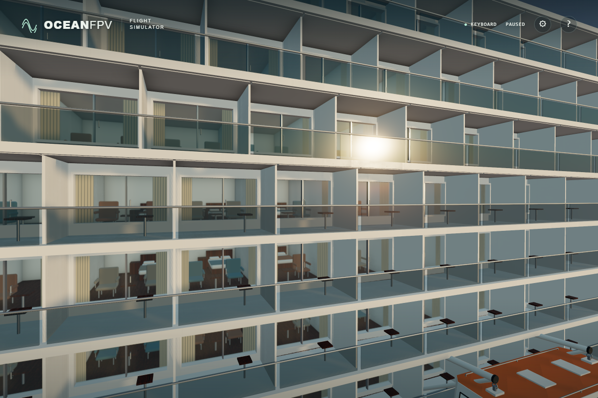
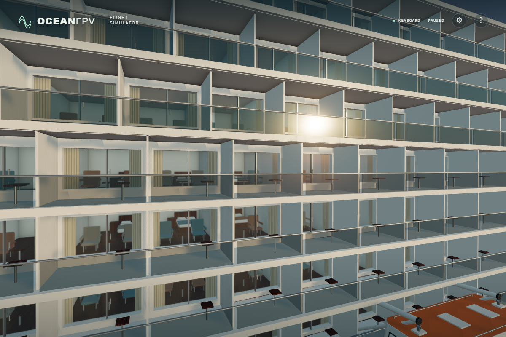

# Balcony guard shadows

The transparent balcony guards were casting solid rectangular shadows across the cabin fronts. Their standard shadow-depth pass did not transmit light according to the visible material's 0.42 opacity. Exclude these guards from shadow casting, as already done for the cabin glazing. Their visible material and shadow reception remain intact.

These raw native ULTRA golden-hour captures compare the same paused world, camera, geometry, exposure, ambient occlusion and materials. Only the guard's `castShadow` flag changes. The improvement is most visible in the rectangular shadow strips beneath the glass; the daylight difference is much smaller.

Before:

After:

The adopted source passes the strict TypeScript/Vite build and a native Direct3D11 check of the minified production build: RTX 4050, ULTRA 1,920 x 1,280, 36 photographic-asset responses, no fallbacks or browser errors. Its bundle is `index-CJzG6Cy8.js`, SHA256 `39af28c0e495d02c2ddc58083135fd3c22da416c282b0f8014eef4d60255ed89`. These local rendering checks do not establish public deployment or physical-controller acceptance.
