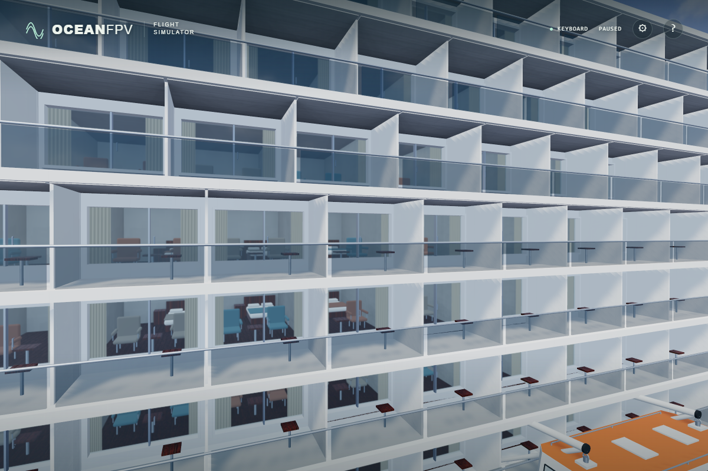

# Full-depth cabin ambient shading

Side cabins are 6.22 m deep, with a diagonal of about 7.5 m, but their ambient-visibility bake only checked nearby geometry within 1.2 m. Extend that caller's range to 8 m, matching the aft-room bake, so far walls and ceilings contribute to the cabin shading.

Before adoption, nine matched native ULTRA captures compared the original range, 8 m and a 50/50 blend on the exact same paused world. Only the side-cabin atlas charts changed. The 8 m version gives the ceilings more coherent depth while keeping furniture visible. The atlas dimensions, ray count, material intensity, lighting and exposure retain their existing values.

The image above is a separate capture of the adopted source, with no atlas replacement or image processing. A recording wrapper returned the original visibility results unchanged and verified all 81,920 side/aft atlas queries used 8 m. Its paused time differs from the earlier prototype comparison; it is not a matched-time before/after pair.

Verification:

- All 142 unit tests and the strict TypeScript/Vite build pass.
- Native actual-source ULTRA captures pass with complete photographic assets and no browser errors. In that single local run, readiness took 45.320 s and the recorded visibility queries totalled 13.558 s. These are observations from that run, not a general startup benchmark.
- The minified production build passes native Direct3D11 ULTRA at 1,920 x 1,280 with 36 asset responses and no errors. Bundle: `index-DDjOZIa1.js`; SHA256: `510656e2a8aa6aa30215427a3d39580a6165f975abc1a97d054f02820ef69678`.

The bake runs during startup, so it adds no per-frame draws or texture samplers. Its startup cost remains measurable. Public deployment and physical-controller acceptance require separate verification.
