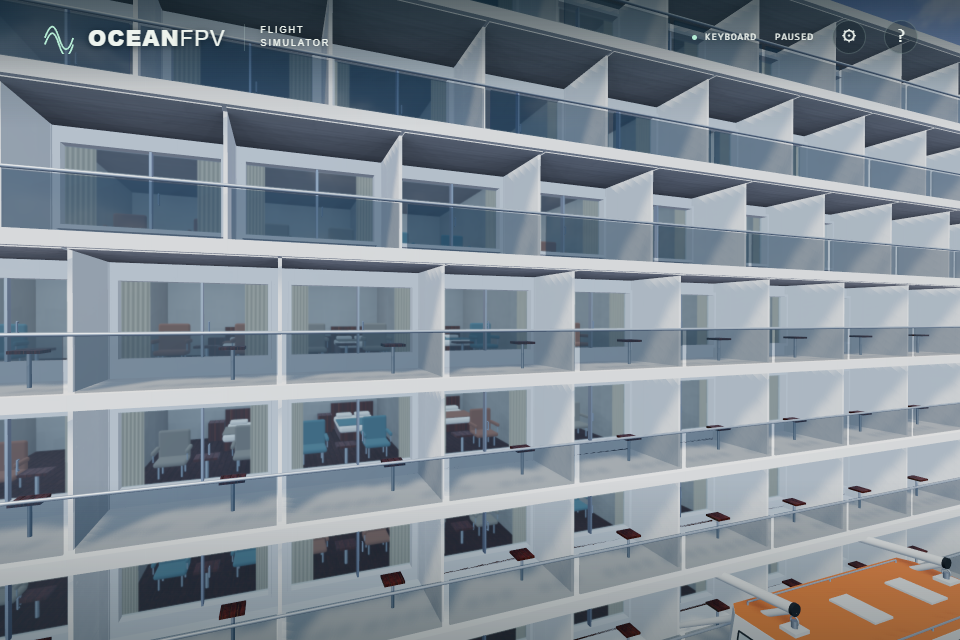

# Exact cabin visibility at startup

The side and aft cabin visibility atlas depends on fixed ship geometry. Generate its original RGBA bytes ahead of time, then load those bytes instead of repeating the same ray queries during every startup. Geometry, collision records, UV charts, ray count, 8 m range and material intensity retain their existing values.

`npm run bake:cabin` uses the actual DOM-free cruise geometry factory. It records every ordered blocker position/index buffer, chart placement, the occlusion algorithm and installed Three.js/BVH versions. `npm run check:cabin` independently rebuilds the atlas and compares all 393,216 bytes and generated metadata without writing files. CI runs this check on shard 1.

The browser validates the byte length and SHA-256 before creating the existing UV1 DataTexture. No image decoder, colour conversion or resampling is involved. Transient failures or invalid data get one deadline-bound reload; permanent missing data and exhausted retries use the original CPU bake. WebGL-unavailable handling remains before the download.

Verification:

- All 153 unit tests and the strict TypeScript/Vite build pass. Nine loader cases cover exact delivery, truncated and same-size corruption, response-body failure, timeout, server failure, permanent 404, repeated corruption and unavailable integrity verification.
- Native browser scene and moving-deck tests pass. They compare the runtime atlas digest with the checked-in data, including a deliberate 404 fallback. The source ULTRA checks additionally verify all texture settings, 19 ship meshes and 57 contact boxes, with complete photographic assets and no unexpected errors.
- Both native source paths produce SHA-256 `32e69b75cea28b14ef36f331abbfb8303d686714f36e4a83e8c98e02558d317f`, identical to the original browser bake. The image above is an unprocessed capture of the normal loaded path; the fallback was captured at a different paused time and is not a matched image pair.
- Minified production passes native Direct3D11 keyboard climb, pause/resume/reset, actual pointer lock and mouse-stick movement. Native ULTRA also passes at 1,920 × 1,280, with 36 photographic asset responses and no errors.

In the two source checks, map restoration took 0.3 ms and the fallback bake took 12,400.9 ms. These measurements exclude download/hash time. Whole-scene readiness was 32.796 s and 30.540 s respectively under different cache conditions, so these runs do not establish an overall cold-start speedup.

Production bundle: `index-BBee254X.js`, SHA-256 `3b497b3175715db56574b9ad0ccd9b00d9ffd6acf7c2edcb51407d814d103a13`. The separate `cruise-occlusion-BrAvGIWN.rgba` file retains the original atlas digest above. Public deployment and physical-controller acceptance remain separate checks.
