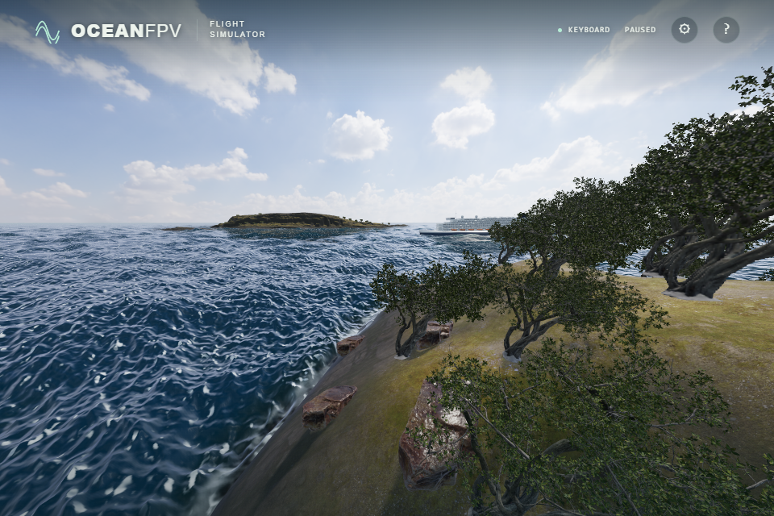

# Coastal tree visibility

Near trees retain the captured 1,072,213-triangle model, its original materials,
shadows and the same nearest-tree selection: one/four/eight trees within 110 m
for BALANCED/HIGH/ULTRA. Each selected tree now has separate instance bounds.
Three.js can test those bounds independently for the main, reflected and shadow
cameras. Bounds are recomputed when selection changes; distant impostors still
exclude exactly the selected trees.

## Matched image checks

Five DAY/SWELL views at frozen time 120 used the same camera, wave field bytes,
ship transform and selected tree matrices before and after `d4a1c23`.
All five raw PNG pairs were byte-identical on native RTX 4050 / Direct3D11 at
ULTRA 1920 × 1280. The source baseline was `bdb7272`; no image processing was used.

| View | Frame triangles before | Frame triangles after | Draw calls before → after |
| --- | ---: | ---: | ---: |
| North | 75,352,698 | 62,376,950 | 441 → 506 |
| East | 79,858,330 | 51,926,196 | 539 → 564 |
| South | 35,966,726 | 20,928,446 | 111 → 131 |
| West | 34,838,498 | 23,044,155 | 150 → 180 |
| Diagonal | 77,116,858 | 55,672,598 | 371 → 416 |

## Bounded GPU timing

The runtime prototype was measured with `EXT_disjoint_timer_query_webgl2` around
the actual main scene render, including nested reflection, transmission and
shadow work. Composer postprocessing is outside this query. Each view used four
warm-up pairs followed by twelve pairs with alternating before/after order.
All queries completed without a GPU-disjoint flag or WebGL error.

| View | Median before | Median after | Before range | After range |
| --- | ---: | ---: | ---: | ---: |
| East | 41.84 ms | 36.13 ms | 39.09–46.71 ms | 33.77–57.33 ms |
| South | 13.01 ms | 10.51 ms | 12.79–13.57 ms | 10.13–11.08 ms |

These two fixed-camera measurements do not establish sustained FPS, flight
performance, other lighting conditions or benefits on every GPU. Draw calls
increase; a view containing every selected tree can have less benefit.

The existing scene browser test also checks twelve quality/location transitions
against the independently selected tree matrices, conservative per-instance
bounds, three camera directions, shadow flags and complete sprite coverage.
It passed with native Direct3D11 and SwiftShader. All 172 unit tests and the
strict production build passed. This change does not resolve the remaining
sea-foam shape or terrain realism limitations.
