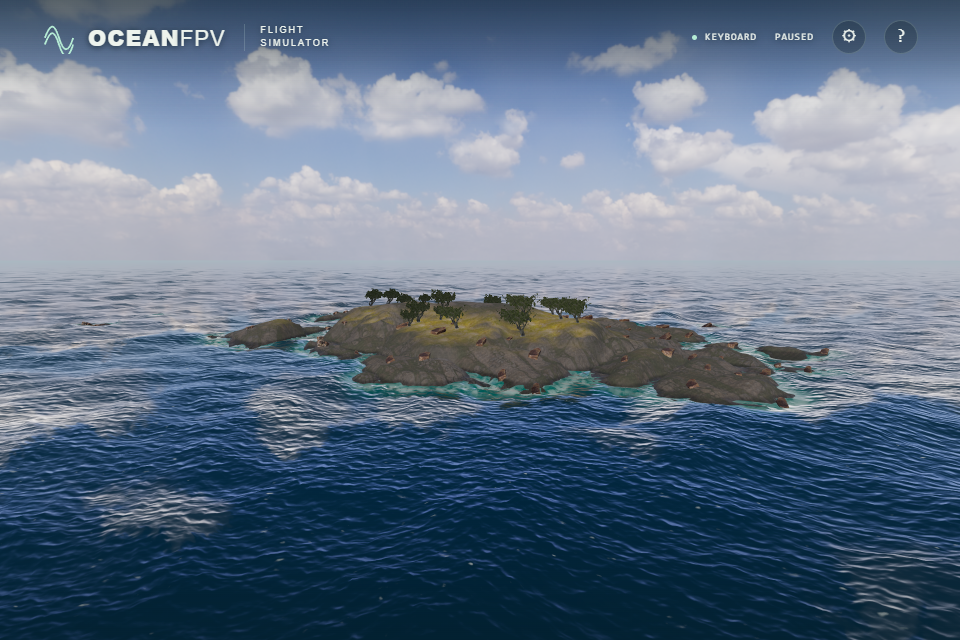

# Coastal water colour and detailed shoreline depth

The previous shoreline colour/foam loop read only the 193² island grid. Waves and flight contacts already used the additional 512² cliff shelf. A scan of the actual photographed cliff found 588 submerged sample points differing by more than 0.25 m, with a maximum height difference of 6.981 m. Shore shading now uses that same detailed bottom at the displaced fragment's world X/Z. The wave source coordinate remains separate for displacement and contact inversion.

The fixed turquoise shallow-water colour is replaced by a bounded contribution from the existing photographed 2 m rock albedo. Its triplanar projection uses the bottom gradient; a missing photograph retains a neutral bed proxy. No image is fetched or allocated again. The photograph is lit by an approximate ambient/direct term, then attenuated over estimated down-going solar and up-going viewing paths. Flat-interface Snell cosines use index 1.333. RGB extinction `(0.45,0.12,0.07)` per metre is a chosen coastal-water approximation, not measured water properties. Deep scattering colour remains the existing `(0.006,0.045,0.082)`.

Exponential transmittance follows the depth-based approximation described in [NVIDIA GPU Gems, chapter 16](https://developer.nvidia.com/gpugems/gpugems/part-iii-materials/chapter-16-real-time-approximations-subsurface-scattering). [Epic's Single Layer Water documentation](https://dev.epicgames.com/documentation/unreal-engine/single-layer-water-shading-model-in-unreal-engine) also separates volume absorption/scattering from surface reflection. OceanFPV does not implement that renderer: it retains its existing Fresnel reflection and crest/foam treatment. There is no refracted scene pass, submerged-object tracing, multiple scattering, caustics or water-quality calibration.

The artificial island skirts stop at 9 m depth. To avoid revealing their square boundary as visible seabed, the photographed contribution smoothly fades between 4 and 8 m and is exactly absent at 8 m and deeper. This is a limit of the shelf proxy, not a physical extinction measurement or a claim of real bathymetry. The heightfield also cannot represent underwater overhangs.

## Matched visual comparison

Both views use the same southwest islet camera, effective FOV65, day light and sea/vessel time120, with a native RTX4050/D3D11 ULTRA1920×1280 render buffer. The PNGs are960×640. The baseline already has corrected cliff depth and untinted photographic ground; the second image is the implemented optical treatment. The former continuous turquoise rim is weaker and the photographed bed blends into the water. This does not resolve repeated boulders or the northern procedural silhouette.

Before:

After:

## Verification

- The production fragment body is tested with controlled pore/noise/normal inputs at77 points, two water heights, two source-coordinate offsets and two normals. The initial616 shallow-colour/foam cases exposed an error of0.9999998 in the old loop. The current probe checks depth/foam directly; native and SwiftShader remain within0.0000241/0.0000668 respectively, below the existing0.003 limit. The original77 height/gradient/attenuation cases remain.
- The actual optical helper passes324 float-target cases against an independent JavaScript exponential/Snell calculation: nine depths including the fade boundary and deep water, three views including grazing, two solar directions, three bottom gradients, and photographed/fallback albedo. Maximum RGB error is2.14e-8 native and1.78e-8 SwiftShader; the limit is0.0001.
- Normal scene, missing fine-detail map and all photographs unavailable pass on the native GPU (3/3). The normal scene verifies shared bed-map identity; missing detail disables it coherently. Ten final main-renderer images cover cliff/islet, near/wide views and day/golden light without page or console errors. These are visual samples, not sustained performance or physical-controller acceptance.

Complete CI and public verification for this follow-up remain pending.
