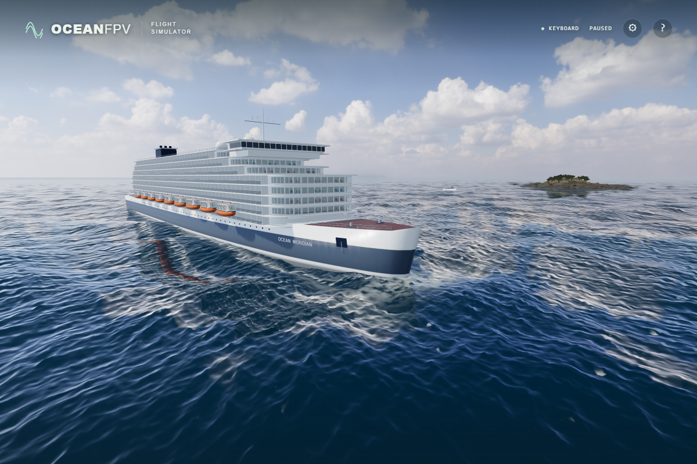

# Raked cruise bow

The liner's upright lower stem made its silhouette look blunt. The first 18% of the forebody now gradually retracts the chine by up to 4 m and the keel by up to 6 m, narrowing them by up to 15% and 10%. Two planar cap bands close the stem without a recessed centre fan. The deck rim, foredeck and aft-body coordinates retain their previous positions.

This raw 1,200 × 800 screenshot shows the actual current source geometry, fitted fixtures and water shader on an RTX 4050. Only the camera was moved while the simulation was paused. It is not the earlier visual-only geometry-swap prototype and received no image processing.

## Surface agreement

CPU fittings query the actual Float32 side triangles. The water shader evaluates the corresponding triangles at each displaced fragment's local height. A maximum 6 m longitudinal rake spans at most three preceding 2.03125 m station intervals, so both queries inspect the current interval and its three predecessors. Drone contact uses the closed interior plus an actual closest-triangle distance of 0.2 m; that physical padding is separate from the water cutout.

## Verification

- All 142 unit tests and the strict TypeScript/Vite build pass. Tests cover closed, outward, nondegenerate triangles; opposite shared-edge directions; Euler characteristic 2; fixed deck/aft positions; actual ray surfaces, fitted names, and independent all-triangle contact distances.
- Native Direct3D11 and SwiftShader each pass 8,872 GPU samples, retaining all previous coverage and adding 200 bow samples: valid upper-stem surfaces, both sides of the actual cap boundary, and a point requiring the third preceding interval. Five poses include a −15 km translation. Cutout mismatches are zero; the original 2 mm global and 0.5 mm untransformed-aft width limits remain.
- Native full-scene checks pass with complete photographic assets, no browser errors, 14 water samplers and a 16-sampler device limit. The actual rendered hull passes 32 bow/aft contact-and-clearance checks. Vessel travel and moving-deck launch also pass.
- The minified production build passes native keyboard climb, pause/resume/reset, actual pointer lock and mouse-stick checks. Native ULTRA draws at 1,920 × 1,280, loads 36 asset responses and reports no errors. These checks do not establish physical-controller acceptance.
- An independent whole-mesh calculation found zero improper intersections among 11,742 AABB-overlapping triangle pairs, zero degenerate faces and zero nonmanifold edges. The 1,546 faces enclose a positive volume of 114,789.704 m³; the minimum station-row step is 1.640869 m.

The procedural shape remains a game model. This change improves its silhouette and keeps rendering and flight contacts aligned; it is not a surveyed reconstruction of a specific ship.
