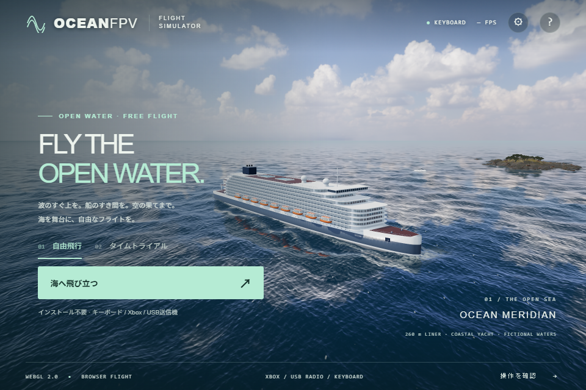
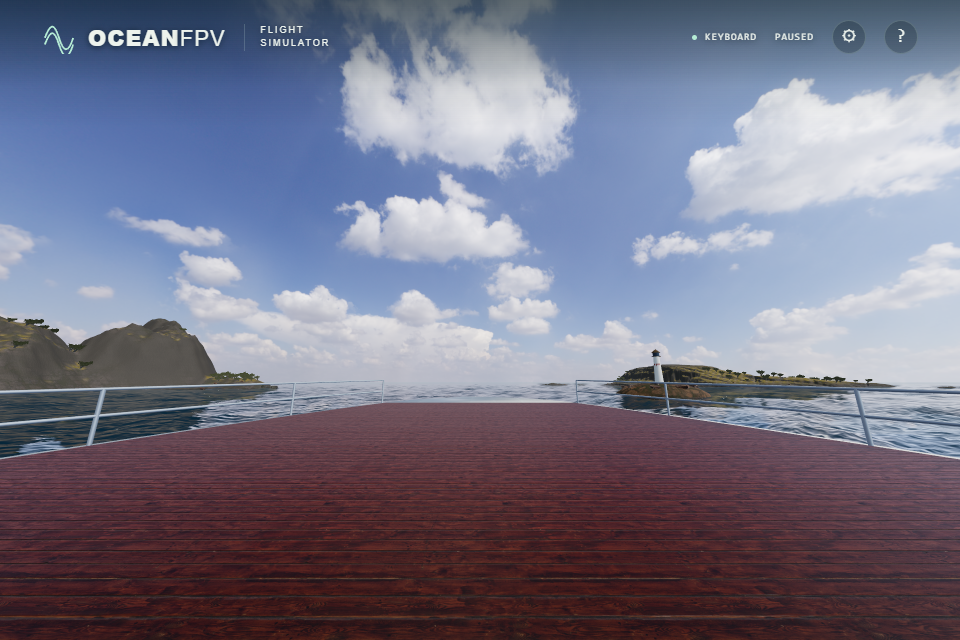

# Cruise departure and open-water route

The 260 m Ocean Meridian is the departure vessel. It sails north along X=0 at 4.2 m/s (about 15 km/h), beginning at Z=220 m. It does not circle, reverse or wrap back to its departure point. The islands flank the open central route; their measured terrain placements are preserved. A 28 m motor cruiser follows a slower coastal route beside the southwest island. The old 92 m vessel, contacts, minimap symbol and ocean wake have been removed.

Each new flight or restart resets the departure and wave time to zero. Pause and resume retain the current position. The launch point is local `(0, 11.835878, -112)`, 1.2 m above the rendered bow deck, facing forward. It inherits the moving deck's velocity. Keyboard, mouse, Xbox mapping and USB transmitter calibration retain their existing controls.

The departure pose stays coupled to the liner until the pilot asks for lift. `DECK READY` identifies this assisted wait; Space, the Xbox left stick or transmitter throttle starts takeoff. A transmitter can remain at zero throttle while waiting. After lift, ordinary flight physics apply. World, flight and race clocks keep advancing during the wait, so riding the liner closer to a gate does not earn free race time. Pause still freezes the simulation.

The original 1,900 m island flight area remains accessible. A 1,200 m radius corridor expands along the route already sailed, keeping the liner and the return route reachable. The altitude limit remains 500 m. Sunlight and shadows follow the camera; the procedural sky remains at its origin for the separate environment cube camera. Preset changes preserve the direction used to bake tree lighting. The race course sits east of the liner's hull and lifeboats.

## Verification

- Navigation and whole-vessel footprint checks cover one hour of route positions, island clearance, continuous wakes, no route wrapping and the return corridor.
- Native RTX 4050 browser checks cover moving-deck launch, a real keyboard climb of more than 3 m, pitch, pause, resume and restart. The production sea-mask probe checks 1,136 points for the two active vessels, with zero mask disagreements.
- The control regressions also wait more than nine seconds on the moving bow before keyboard takeoff, and verify zero-throttle transmitter waiting followed by an actual climb. Keyboard, radio and ordered-race checks use a 320 by 240 buffer to bound software-rendering cost; full-scene and ULTRA image checks retain their separate larger buffers.
- At 0, 600, 1,800 and 3,600 seconds, browser checks verify clear launch air, contacting deck, stable cube-camera origin and matching day/evening/night sunlight and tree-atlas directions. These are sampled time positions, not a sustained one-hour flight.
- The race check crosses 18 real gate planes through animation and flight physics, completes the course and stores the result. It also induces a 10.1 second main-thread stall, verifies recovery through the normal Resume button and continues the race. The production 10 second stall safeguard is retained.
- Full source captures use ULTRA, a 1,920 by 1,280 drawing buffer and native Direct3D11. The paused FPV still hides only the dialog overlay and HUD; no image processing changes the rendered scene.

Physical Xbox/transmitter hardware, other GPUs and sustained long-session performance remain unverified. The ship is an original procedural model. These changes do not establish whole-game visual completion.
