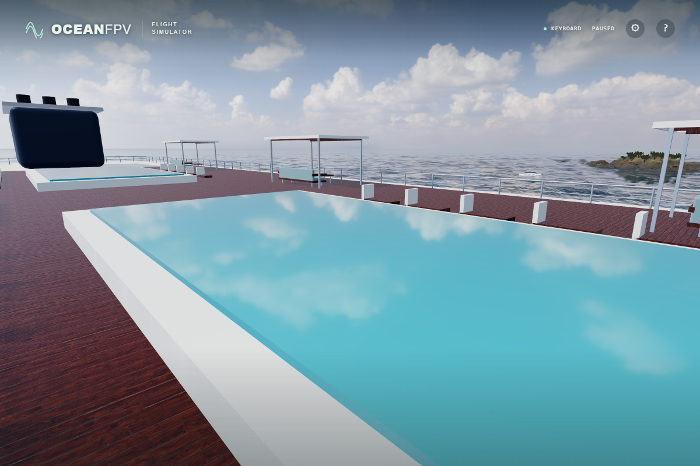
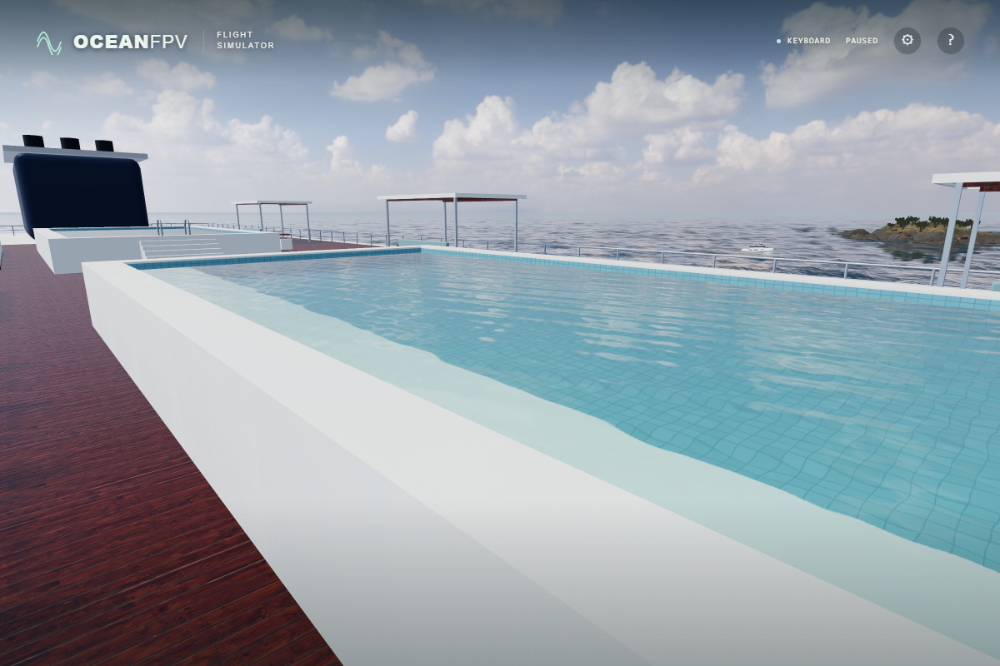
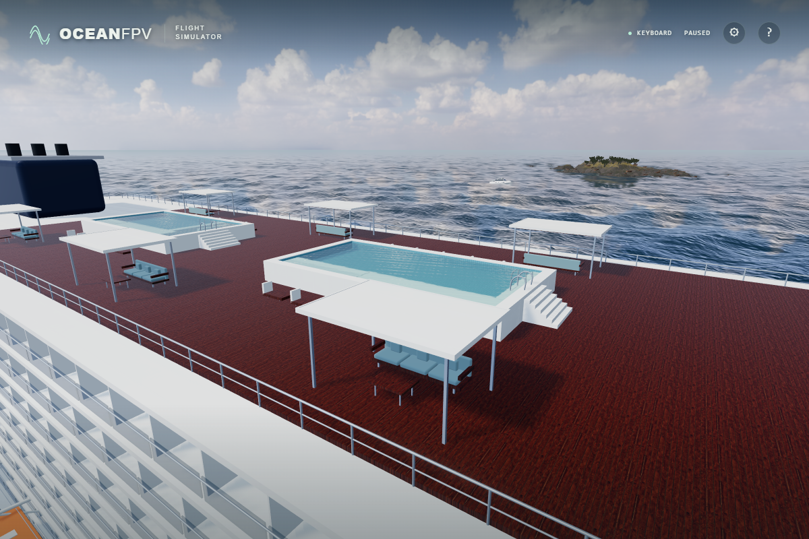

# Raised pools with real depth

The old cyan surface sat 0.10 m above its surrounding white box. Both pools now have closed walls, a tiled bottom 1.10 m below the water, and coping 0.18 m above it. The raised tanks sit on the existing timber deck without cutting through the cabins underneath. Six supported treads and the coping landing provide seven equal 0.20 m rises at each short end. Curved handrails and three ladder rungs lead into each basin.

Before:

After:

These are unprocessed native ULTRA captures. The before/after rim views use identical time 0, ship transform, camera and daylight; both rim and deck views were also compared under golden lighting. The deck image shows the new layout under daylight.

Water uses Three.js [physical transmission](https://threejs.org/docs/pages/MeshPhysicalMaterial.html), IOR 1.333, depth attenuation and two moving normal samples from a filtered, periodic ripple texture. The opaque tiles have metre-scaled 15 cm grout. Water remains reflective while transmitting the bottom and does not cast an opaque shadow. This is a screen-space optical approximation with environment reflections, not a fluid, caustic or dedicated planar-reflection simulation.

Contacts follow the actual walls, supported steps, ladder segments and water volume with the existing 0.20 m drone clearance. Finite sweeps catch narrow surfaces without extending beyond the flight path. Space above the basins and the surrounding aisles remains open.

Verification: 166 unit tests, the strict TypeScript/Vite build and the byte-identical cabin atlas check pass. The new browser case passes on native Direct3D11 and software SwiftShader, raycasting both real water/bottom pairs and checking material settings, contacts, fast stair crossings and clear air/aisles. The browser suite contains 34 cases; the complete suite was not rerun locally for this addition. Minified native acceptance passes keyboard climb, pause/resume, reset, pointer lock and mouse input; ULTRA passes at 1,920 × 1,280 with 36 photographic asset responses and no unexpected errors. Normal keyboard flight advances the retained ripple uniform with simulation time, and the normal pause handler freezes both without assigning diagnostic time or phase.

Software verification retains the physical water in BALANCED. Static terrace contacts use the normal help dialog to freeze unrelated menu redraws during imports and raycasts. The race physics case uses a supported 65-degree FPV lens, normal flight/menu handlers and bounded safety-pause recovery, retaining all 18 crossings, the 60 s warmup and 20 s crossing limits. Its outer budget reserves these phases; per-gate progress remains visible if a run fails. A redundant success-only diagnostic PNG is omitted from CI; all scene assertions and failure traces remain.

The pool surface has only front-facing triangles. A camera below its vessel-local plane cannot see any water pixels, but Three.js still schedules a transmission background pass unless the mesh is excluded before render-list construction. The scene now tests that actual plane for each perspective camera, including reflection cameras, and restores visibility after each nested render. Near-plane, unknown-camera and double-sided cases retain visibility. Material settings, water geometry, contacts and quality presets are unchanged.

Matched native BALANCED captures at 640 × 480, time 58.7667 and FOV 65 are byte-identical before/after for both a low flight view and the view into the pool:

| View | Before draws / triangles | After draws / triangles | PNG SHA-256 |
| --- | ---: | ---: | --- |
| Low flight at gate 12 | 319 / 16,847,725 | 164 / 8,445,689 | `03ca16e28c26c9b2d1514a75ea26391b12a8ad53e06b927a2edff3372f5ee6b4` |
| Above the pool | 242 / 10,276,871 | 242 / 10,276,871 | `48d524b13409794df9b4b6f286fcdd302cfcbe18fb96be9f5c62a887d3742d40` |

After three warmup draws, the low-view three-second explicit-redraw sample changed from mean 21.83 ms / p95 63.5 ms to 16.65 ms / p95 21.0 ms on the native RTX 4050/Direct3D11. The above-pool sample stayed at 16.68 ms mean. These are bounded, paused-view samples, not sustained gameplay or GPU-only timings. HIGH/ULTRA cabin glazing can independently require transmission passes. After the correction, the actual race case passes on native Direct3D11 and SwiftShader, including all 18 crossings, the intentional 10.1 s safety stall and completed-run persistence, without incidental safety recovery in either local run.

Production: `index-BzOeIr_y.js`, SHA-256 `09920d92d1ad062f3fe65ba0dee0ec2d53cc8e85d1aa0da052be94dd19ca2285`. Public deployment, sustained hardware performance and physical Xbox/FPV-radio acceptance remain separate checks.
