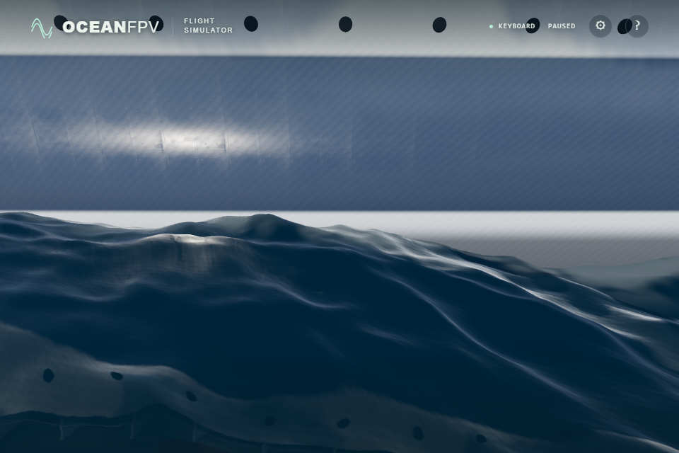

# Cruise hull and sea intersection

The cruise water cutout now follows the actual hull section at the displaced sea fragment's height. The previous mask used the upper rim at every height, which could remove visible water outside the narrower submerged hull. It also omitted the ship's heave and pitch.

Independent rays against the rendered Float32 mesh measured the old cutout boundary **0.128–0.406 m outside the hull** per side at sampled flat-root sea-level sections. All 90 boundary witnesses across five heights were outside the hull. These are controlled geometry measurements, not measurements from a public screenshot.

The shader follows the same upper/chine/keel triangle bands and port/starboard diagonals as the mesh. It rejects points beyond the hull's ends, bottom and upper surface, then applies the existing 0.98 inset to that section's width. The displaced world point is translated by the actual vessel origin before inverse rotation; this preserves precision along the straight sailing route. World updates supply the current inverse matrix and heave. The yacht mask, wake and foam calculations retain their previous behavior.

## Matched native views

Both images use the same paused time, ship pose, camera, ULTRA settings and loaded materials. The first reinstates the exact old mask block and width helper from source `8b78e4b`; the second uses the unmodified corrected production shader. Only overlays are hidden. The files are unprocessed browser captures, not two separate production releases.

Before:

After:

The triangular hull shadow bands visible in this pair are addressed independently in [PR #51](https://github.com/lingmulongtai/OceanFPV/pull/51). This branch does not include that change. The bow silhouette and broader ship realism still need further work.

## Verification

The GPU probe extracts the real production cutout block. Its reference widths come from independent Raycaster intersections with `cruiseHullGeometry()`, rather than a second copy of the shader formula. It covers both sides, upper and lower triangle bands, chine-adjacent heights, end/vertical exclusions and five poses with heave, pitch, yaw and translations to −15 km. Samples lie 5 mm on either side of the inset boundary. Existing yacht samples remain.

| Check | Native RTX 4050 | SwiftShader |
| --- | ---: | ---: |
| Total samples / cruise samples | 8,672 / 8,104 | 8,672 / 8,104 |
| Cutout mismatches | 0 | 0 |
| Maximum width error | 0.629 mm | 1.343 mm |
| Maximum posed width error | 0.629 mm | 0.606 mm |
| Untransformed aft width error | 0.004 mm | 0.004 mm |

The original 2 mm overall and 0.5 mm untransformed aft bounds remain. Subtracting the origin before rotation reduced a trial's 2.212 mm software error below these bounds.

All 140 unit tests and strict TypeScript/Vite build pass. Native full-scene verification retains 14 water samplers within the 16-unit device limit, complete photographic materials and zero browser errors. At 0/600/1,800/3,600 simulated seconds and all three light presets, the actual world origin and inverse matrix remain aligned with the rendered ship; departure air, deck contacts and lighting also pass. Three paired waterline views use identical paused world state and have no browser errors.

These checks establish the sampled geometry and rendered behavior. They do not establish sustained frame rate, physical controller acceptance, or a photorealistic final ship.
