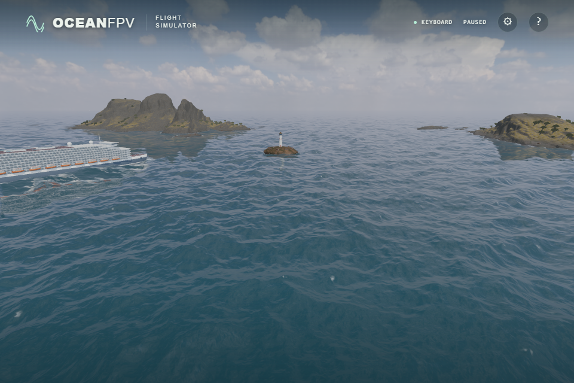

# Softer environmental reflection on waves

The sea's broad pale contours remain visible with foam and the direct sun glint
disabled. The environment-reflection weight was using every resolved ripple's
normal. Blurring the reflected image alone did not smooth that sharply varying
Fresnel weight.

Following [web-ocean's sky-reflection block at the reviewed commit](https://github.com/Noniv/web-ocean/blob/a07c7fd522ef0a897601c114f927a49d93d95520/js/wgsl/ocean.js),
environmental Fresnel now uses a normalized blend of the wave normal and up,
with an up weight of 0.45. The existing water reflectance and grazing clamp
remain. The original normal still drives reflected directions, direct sunlight,
foam illumination, crest scattering and wave geometry. The environment and
water-body weights remain complementary.

This is the reference's appearance heuristic, not a physically validated
integration of visible wave facets. The continuous contours are reduced in the
sampled views; they are not eliminated, and this does not establish complete
photorealism. Neither the reference's covariance-dependent reflection-direction
bias nor its underwater-direction fold is included in this change.

## Matched visual comparison

One native RTX4050 / Direct3D11 run captured 36 raw PNGs: DAY/GOLDEN, side,
sunward and elevated views, full shading/foam disabled/foam and direct glint
disabled, and baseline/candidate. Both variants use the same shader with only
the environment-normal blend changed through a diagnostic uniform.

Within each view all nine displacement/tangent field hashes, actual simulation
time, camera, vessel transform, height/chop scales and FOV65 match. The game
ran for ten seconds, then its ordinary help dialog froze it. Camera relocation
and diagnostic uniforms are development comparison tools, not ordinary-flight
acceptance. ULTRA's framebuffer is 1920×1280; these unedited screenshots retain
the browser's 960×640 CSS viewport output.

| Existing environmental Fresnel | Adapted normal blend |
| --- | --- |
|  |  |

The reduced contrast persists with foam and direct glint disabled, isolating
the environmental term. The original glint BRDF and foam implementation are
unchanged. The comparisons are evidence for these views, not sustained FPS or
physical-controller acceptance.

## GPU regression

The existing production sun/reflection-block probe covers 54 combinations of
view/light elevation, surface normal and unresolved variance. The environmental
oracle reconstructs the blended normal through tilt and azimuth in double
precision. It also checks bounded reflectance, unchanged flat-water Fresnel,
and the direct-sun angle, normal invariance and radiance connection.

| Renderer | Maximum environment Fresnel error | Maximum direct-sun Fresnel error |
| --- | ---: | ---: |
| RTX4050 / Direct3D11 | 0.0000000479 | 0.0000000533 |
| Forced SwiftShader | 0.0000001671 | 0.0000001562 |

Both passed with GL/browser errors zero. There is no new texture, sampler,
render pass or quality reduction. The reference's [full MIT notice](../public/licenses/web-ocean.txt)
remains shipped. Whole-product and public-deployment acceptance are separate
checks.
