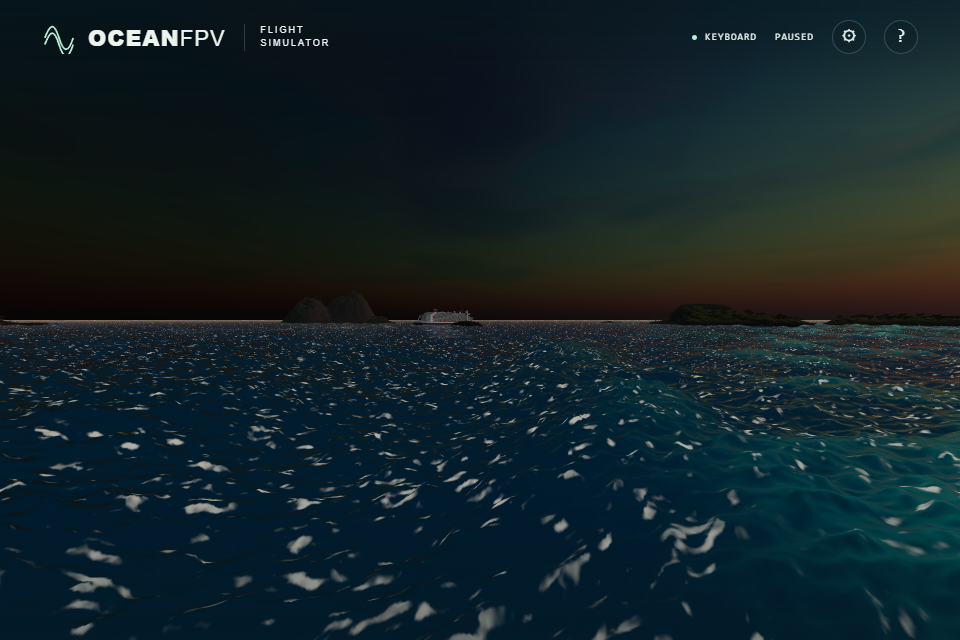
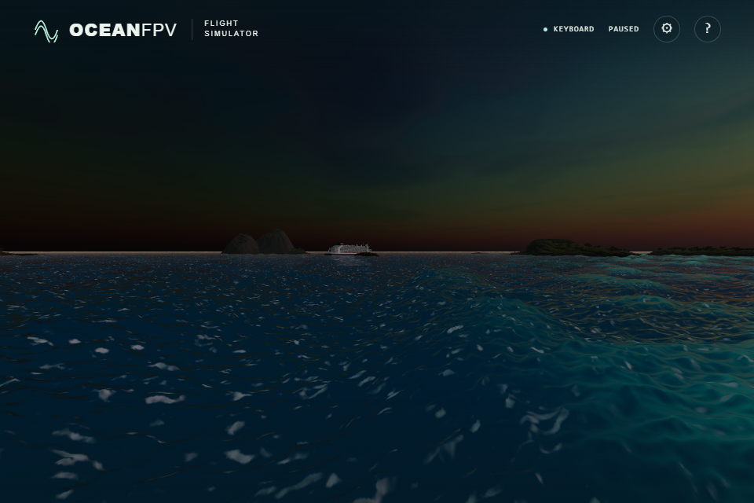
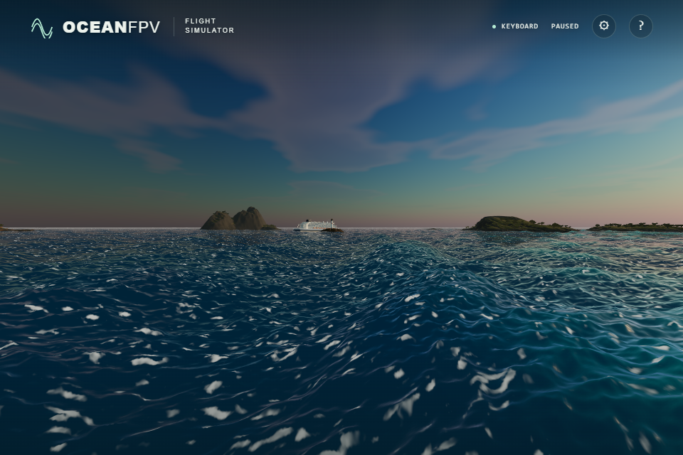

# Sea foam under scene lighting

Foam previously used nearly fixed radiance, with a manually warmed dusk colour. Pale patches stayed prominent over dark water. Foam now has a fixed linear albedo and receives the scene's directional sunlight, hemisphere light and diffuse PMREM environment. Light colour, intensity, surface orientation and environment rotation all affect its appearance.

The existing environment texture is reused. There is no additional sky bake, asynchronous readback or exposure adjustment. Environment sampling follows Three.js `getIBLIrradiance`: the roughness-one CubeUV sample is multiplied by π and scene intensity, then all irradiance is converted to Lambertian radiance with albedo/π. Atlas dimensions come from the actual PMREM; its inverse rotation is synchronized immediately before rendering, including startup and light-setting changes.

Blue-light SWELL before:

After:

Golden-light SWELL before:

After:

These are unprocessed native ULTRA browser screenshots. Six matched pairs cover day/golden/blue light and grazing/elevated views. The before mode restores only the exact production foam-colour expression from commit `1348301`; both modes share the same camera, FOV 95, wave/vessel time 120, spectral displacement bytes, ship transform, sun and 1,920 × 1,280 framebuffer. PNG output is the browser's 960 × 640 viewport. Six more pairs suppress only the final foam blend; every before/after PNG in those pairs is byte-identical. Water radiance, sky reflection, sun glint, wave geometry and foam coverage retain their existing calculations.

The new regression executes the actual production foam expression and illumination function into a floating-point target. Its 70 cases use real World light presets, an analytically known constant PMREM, isolated sunlight/hemisphere light, darkness and a directional PMREM under Y and three-axis rotation. The old colour expression has maximum error 0.71632 and no response to environment direction. The correction passes on RTX 4050/Direct3D11 (maximum error 0.001232) and SwiftShader (0.000086), below the 0.003 tolerance for the half-float PMREM; rotation error is zero on both.

The existing sun, wake and cliff-optics GPU fixtures now inherit the production shader defines. All four related GPU cases pass on both renderers, along with 168 unit tests, the strict TypeScript/Vite build and the unchanged cabin atlas. The browser suite contains 36 cases; the full suite was not rerun locally for this addition.

This uses Three's diffuse-environment approximation, not an exact cosine integral or a calibrated foam-scattering model. The scene's existing environment-plus-sun addition is retained, including any overlapping solar contribution. Foam still lacks local ship shadows, and its patch shapes and the broader reflection pattern remain separate realism limitations.

Production bundle: `index-DNOhGaMj.js`, SHA-256 `6cb288f29b6572435fd1cc70be689f45ced67937236f9884843839efa2a9fa7c`. Public deployment and physical-controller acceptance remain separate checks.
