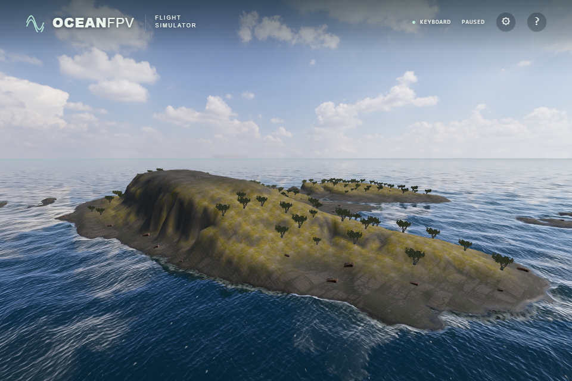

# Measured northeastern coast

The northeastern procedural cone is replaced by a derivative of Hornøya's 1 m terrain data. Its main land component spans approximately 730 × 916 m, with inlets and detached islets. The 1200 m square is translated to game centre (800,-900), without horizontal or vertical exaggeration. This is a fictional map: the scenery, vegetation, separate boulders and sea are not a reconstruction of Hornøya's environment. The southwestern measured island remains unchanged; the northwestern headland retains procedural terrain and its captured cliff.

Source: ©Kartverket, [DTM1 tile 33-179-197](https://nedlasting.geonorge.no/hoydedata/DTM1/33-179-197.tif), [CC BY 4.0](https://creativecommons.org/licenses/by/4.0/), [provider terms](https://www.kartverket.no/api-og-data/vilkar-for-bruk/). The source window is [13070,6160,14270,7360), with first pixel centre E1098495.5/N7889844.5 in ETRS89 / UTM33N. Rows run south, matching positive local Z. The vertical datum is unconfirmed. The source's custom GeoTIFF coordinate keys, origin, resolution and reviewed header are checked before decoding.

## Reproduction and edits

```sh
npm ci
node --import tsx scripts/fetch-hornoya.ts artifacts/hornoya-source.f32
npm run import:northeast -- artifacts/hornoya-source.f32
```

The acquisition checks ETag `"62d5544c-243f8a70"`, exact HTTP206 ranges, response length and a 64 KiB header hash. It rejects complete-file responses, changed versions, truncated/oversized bodies, and transfers exceeding 16 MiB. The complete 608,143,984-byte TIFF was not downloaded or hashed. The verified acquisition transferred 3,407,872 bytes in nine requests. An adjacent `.ranges.json` records each requested range and hash.

The extracted 1200² little-endian Float32 crop has SHA-256 `ecf683cab48d07de9c99b0381963d4998ff455e01cb5aeb3c4071f4a535caf7b`; this is a crop hash, not a full TIFF hash. The importer checks it before preparing data. Land above 0.3 m is retained, except components touching the crop boundary. Water becomes synthetic chamfer-distance depth ×0.4, capped at 9 m. No measured bathymetry is supplied. The crop is resampled to 769² vertices at 1.5625 m spacing, with millimetre integer encoding stored as JSON numbers in a signed 32-bit range. Millimetre encoding does not imply survey accuracy. All four outer edges are −9 m.

The original maximum is 67.064354 m; the sampled game grid peaks at 67.045 m. The generated JSON SHA-256 is `fbcf57b97a6ed7bb3400b0858d689ded1d056d6ee062d11d93fe24a8d9494b90`. Every fourth fine vertex retains the exact encoded height of the original 193² grid (SHA-256 `fc0673a084737f853bc341fc11a6d7a6b51f1acb4bfbe3f9d8a3607913e92650`). Raw-pixel witnesses cover the new summit and steep cliff as well as the former samples. At cell (217,487), the fine height is 42.258 m; the old coarse triangles yielded 24.4095 m there. The finer mesh retains this surveyed relief without height exaggeration. The southern island's original importer, 16-bit rejection test and generated JSON bytes are preserved.

## Integration and verification

The northeastern mesh has 591,361 vertices and 1,179,648 triangles; the other island meshes retain 192 segments. Rendering, triangle contacts, slopes and vegetation use the fine grid. A dedicated nearest-sampled Float32 ocean texture uses those same heights and triangle diagonals. Inside the island extent it replaces the coarse green channel, rather than taking their maximum, which would incorrectly fill the finer valleys. The shared 193² depth input remains intact for the other islands and the separate captured-cliff field. Captured rocks require at least 80% of their bottom samples to sit inside actual ground. The new island has 79 accepted captured rocks and 157 trees on dry slopes. Normal total rock count is 218; missing-cliff recovery has 226. Fallback rocks use the same candidate positions.

- All 136 unit tests and the strict build pass. Independent raw-pixel witnesses, both mesh triangle halves, every uploaded vertex, dry tree roots and rock support are covered. All three ship footprints remain in water through 360 route phases. Every positive fine-grid terrain cell fits within the existing 1900 m flight boundary.
- Native RTX4050/D3D11 scene, missing-cliff, rock fallback, partial texture fallback, ship movement/launch, keyboard flight and terrain-contact checks pass. Both measured islands have twelve dry ray hits that contact the actual surface, while points 0.6 m above remain free. Normal material loading produces no network failures or browser errors. Ground material samplers remain 10 of 16 available; the production water shader uses 14 of 16.
- Native and SwiftShader pass 5,124 GPU nearshore cases, 896 mip cases and twelve direct bottom height/gradient reads. New-island depth targets cover land, waterline and depths through 8.2 m on both triangle halves. Direct reads also cover tall cliffs and the summit, where wave attenuation alone would hide a wrong land height. Existing tolerances are unchanged. Maximum native wave height/contact differences are 2.810/2.694 mm; SwiftShader 0.208/0.144 mm. Direct bottom maximum absolute differences are 0.000170 native and 0.000090 SwiftShader. Actual terrain/reef contacts also pass on SwiftShader.
- Four actual renderer captures cover two cameras and day/evening light, with no browser errors or missing materials. The matched images below use RTX4050, a 1920×1280 ULTRA render buffer, effective FOV65 and wave/vessel time120. Both use eye (440,90,-400) looking at (820,20,-890); PNGs are 960×640. The original cone had a nominal 190 m height setting and a different centre; the camera is unchanged.

Photographic terrain still shows large repeated slab patterns; the finer mesh improves the silhouette and cliffs but does not resolve material repetition. Rock shapes and tree distribution are repeated game assets. The larger JSON increases the main bundle to approximately 4.18 MB (0.87 MB gzip). Sustained performance, other GPUs, physical Xbox/USB radio acceptance and public deployment of this change remain separate checks.

Before:


Initial measured coast at 6.25 m spacing:



Detailed measured coast at 1.5625 m spacing:


