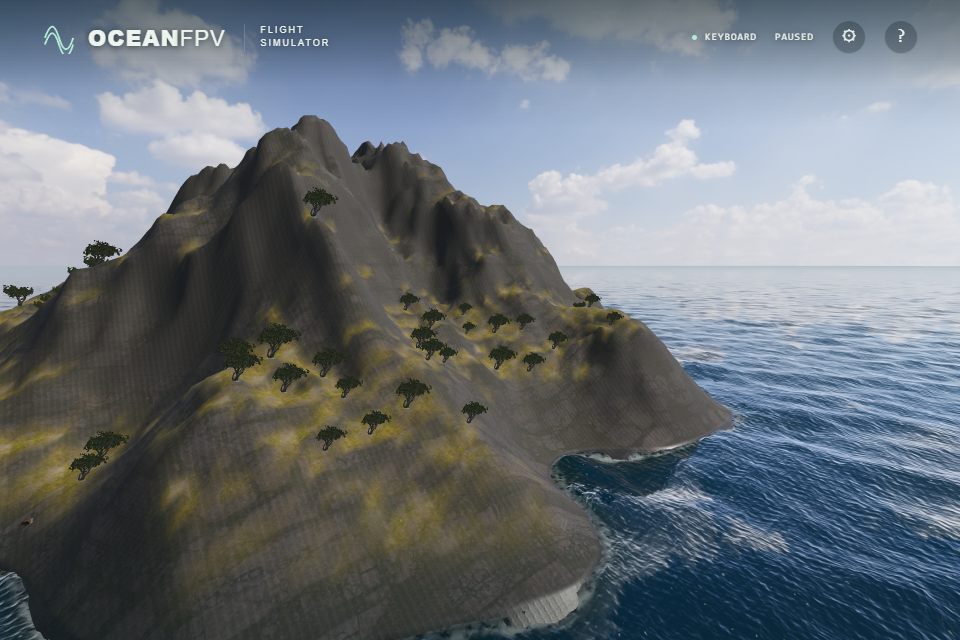
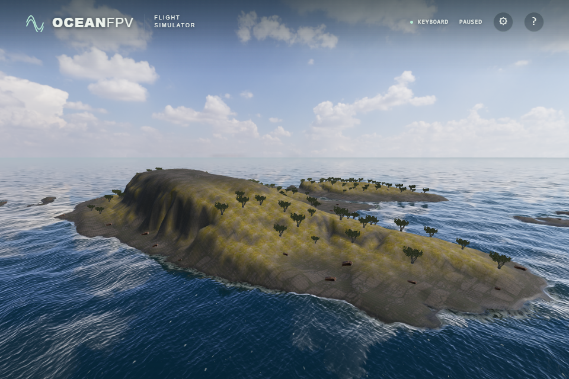

# Measured northeastern coast

The northeastern procedural cone is replaced by a derivative of Hornøya's 1 m terrain data. Its main land component spans approximately 730 × 916 m, with inlets and detached islets. The 1200 m square is translated to game centre (800,-900), without horizontal or vertical exaggeration. This is a fictional map: the scenery, vegetation, separate boulders and sea are not a reconstruction of Hornøya's environment. The southwestern measured island remains unchanged; the northwestern headland retains procedural terrain and its captured cliff.

Source: ©Kartverket, [DTM1 tile 33-179-197](https://nedlasting.geonorge.no/hoydedata/DTM1/33-179-197.tif), [CC BY 4.0](https://creativecommons.org/licenses/by/4.0/), [provider terms](https://www.kartverket.no/api-og-data/vilkar-for-bruk/). The source window is [13070,6160,14270,7360), with first pixel centre E1098495.5/N7889844.5 in ETRS89 / UTM33N. Rows run south, matching positive local Z. The vertical datum is unconfirmed. The source's custom GeoTIFF coordinate keys, origin, resolution and reviewed header are checked before decoding.

## Reproduction and edits

```sh
npm ci
node --import tsx scripts/fetch-hornoya.ts artifacts/hornoya-source.f32
npm run import:northeast -- artifacts/hornoya-source.f32
```

The acquisition checks ETag `"62d5544c-243f8a70"`, exact HTTP206 ranges, response length and a 64 KiB header hash. It rejects complete-file responses, changed versions, truncated/oversized bodies, and transfers exceeding 16 MiB. The complete 608,143,984-byte TIFF was not downloaded or hashed. The verified acquisition transferred 3,407,872 bytes in nine requests. An adjacent `.ranges.json` records each requested range and hash.

The extracted 1200² little-endian Float32 crop has SHA-256 `ecf683cab48d07de9c99b0381963d4998ff455e01cb5aeb3c4071f4a535caf7b`; this is a crop hash, not a full TIFF hash. The importer checks it before preparing data. Land above 0.3 m is retained, except components touching the crop boundary. Water becomes synthetic chamfer-distance depth ×0.4, capped at 9 m. No measured bathymetry is supplied. The crop is resampled to 193² vertices at 6.25 m spacing, with millimetre integer encoding stored as JSON numbers in a signed 32-bit range. Millimetre encoding does not imply survey accuracy. All four outer edges are −9 m.

The original maximum is 67.064354 m; the sampled game grid peaks at 66.984 m. The generated JSON SHA-256 is `fc0673a084737f853bc341fc11a6d7a6b51f1acb4bfbe3f9d8a3607913e92650`. All 37,249 encoded heights match the independently prepared native-resolution trial within 0.501 mm. The southern island's original importer, 16-bit rejection test and generated JSON bytes are preserved.

## Integration and verification

Rendering, triangle contacts, slopes, vegetation and the green ocean-depth channel use the same measured heights. Captured rocks follow the irregular shelves and require at least 80% of their bottom samples to sit inside actual ground. The new island has 80 accepted captured rocks and 167 trees on dry slopes. Normal total rock count is 219; missing-cliff recovery has 227. Fallback rocks use the same candidate positions.

- All 133 unit tests and the strict build pass. Independent raw-pixel witnesses, both mesh triangle halves, every uploaded vertex, dry tree roots and rock support are covered. All three ship footprints remain in water through 360 route phases. Positive terrain cells fit within the existing 1900 m flight boundary; the farthest positive grid vertex is approximately 1614.014 m from the origin.
- Native RTX4050/D3D11 scene, missing-cliff, rock fallback, partial texture fallback, ship movement/launch and terrain-contact checks pass. Both measured islands have twelve dry ray hits that contact the actual surface, while points 0.6 m above remain free. Normal material loading produces no network failures or browser errors; ground material samplers remain 10 of 16 available.
- Native and SwiftShader pass 5,124 GPU nearshore cases and 896 mip cases. New-island depth targets cover land, waterline and depths through 8.2 m on both triangle halves. Existing tolerances are unchanged. Maximum native height/contact differences are 2.810/2.712 mm; SwiftShader 0.208/0.144 mm.
- Four actual renderer captures cover two cameras and day/evening light, with no browser errors or missing materials. The matched images below use RTX4050, a 1920×1280 ULTRA render buffer, effective FOV65 and wave/vessel time120. Both use eye (440,90,-400) looking at (820,20,-890); PNGs are 960×640. The original cone had a nominal 190 m height setting and a different centre; the camera is unchanged.

Photographic terrain still shows repetition and smooth areas at this mesh resolution. Rock shapes and tree distribution are repeated game assets. Sustained performance, other GPUs, physical Xbox/USB radio acceptance and public deployment of this change remain separate checks.

Before:



After:


