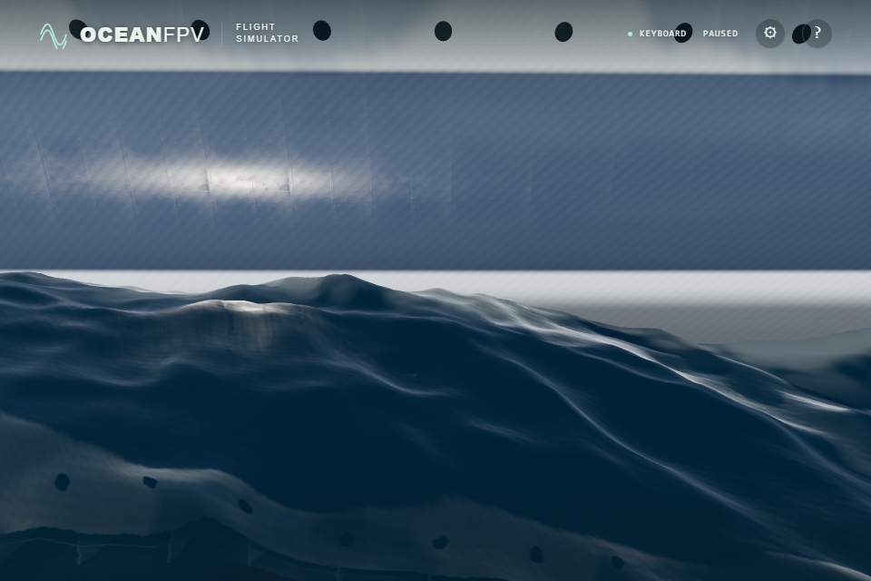
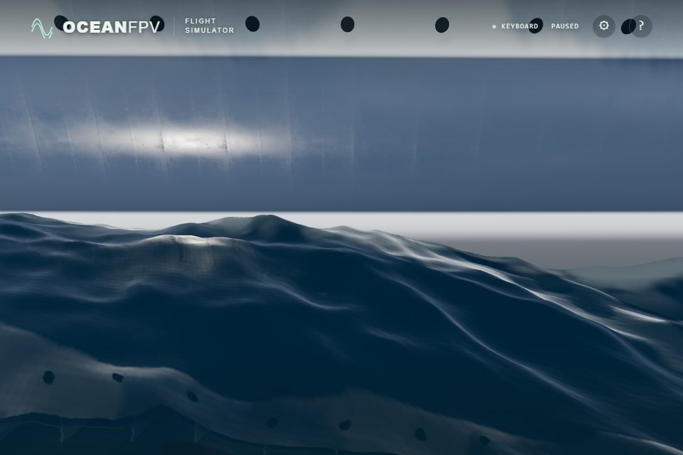

# Cruise hull shadow repair

Flying beside the hull at water level exposed diagonal bands across the paint. In a controlled native GPU comparison, removing normal-map perturbation left the bands, while disabling received shadows removed them. Increasing the global normal bias reduced the pattern but did not remove it completely.

The closed cruise hull now casts its depth shadow from its back faces. Its visible material remains two-sided and the hull still receives shadows. This removes self-shadow interference without raising the scene's bias or changing the painted-metal texture. The rule is specific to this closed opaque hull, whose topology is covered by the existing hull tests.

## Controlled comparison

Both images use the same paused camera and wave state, ULTRA at 1,920 by 1,280, and native RTX 4050 Direct3D11. The second image changes only the hull's shadow-casting side to the adopted setting. The pause overlay and telemetry are hidden with CSS; the rendered images are otherwise unmodified. Separate source captures at starboard, bow and port confirm the adopted setting. These are local controlled captures, not public or sustained-flight evidence.

## Verification and limits

- All four cruise-hull geometry/contact/closure tests and the strict TypeScript/Vite build pass.
- Three native ULTRA source views load complete photographic materials with no browser errors; bow and starboard views were inspected.
- An isolated native render uses the actual `buildCruiseShip` hull and material. An independent geometry ray confirms that a ground receiver lies behind the hull. Its rendered brightness changes from 0.8491 without the hull casting a shadow to 0.0933 with it. A lit hull-front sample remains 0.4052 in both cases, with received shadows enabled. These are controlled shader outputs, not calibrated photometric measurements.
- The waterline mask still projects the upper rim rather than following the displaced water/hull intersection. Separate geometric measurements found excess cutout width; that issue is not fixed by this shadow change. The bow silhouette and broader material realism remain further work.
