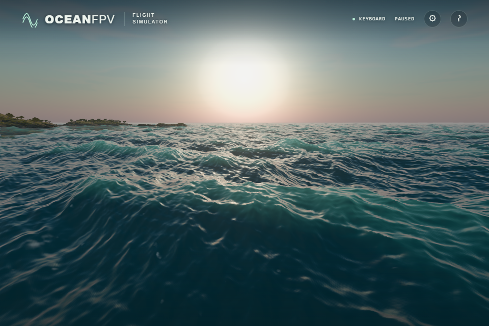

# Local slope filtering and directional sun reflection

The filtered slope moments and Gaussian/Smith sun model are adapted from
[web-ocean](https://github.com/Noniv/web-ocean/tree/a07c7fd522ef0a897601c114f927a49d93d95520),
with its [MIT notice retained](../public/licenses/web-ocean.txt).

## Filtered wave statistics

Three 128 × 128 RGBA16F array layers store the world-height slope second
moments `(Hx², Hz², HxHz)`. The shader subtracts the filtered mean outer product,
maintains a positive-semidefinite covariance and combines bands with squared
height gains. The horizontal displacement Jacobian transforms that covariance
into deformed world coordinates. Existing coastal height/gradient approximations
retain a continuous fallback to the global variance.

The array consumes one additional sampler: native production water now uses
16 of 16 available bindings. Explicit bilinear/trilinear reads retain consistent
half-float filtering on the tested Direct3D11 and SwiftShader backends. Mipmap
generation requires the float render-target extension; unsupported contexts use
the existing global variance. HIGH and ULTRA enable local statistics. BALANCED
uses the global shading path, but still refreshes the moment storage; no CPU or
frame-rate improvement is claimed.

## A consistent wave-surface frame

The full covariance drives an anisotropic Gaussian slope distribution and Smith
masking for direct sunlight. Both use the resolved normal's tangent frame. The
world-to-local slope covariance is linearized about that normal; at X tilt θ,
the two slope axes scale by `cos²θ` and `cosθ`. Isotropic ripple variance and
the existing normal-footprint broadening remain approximations. PMREM sky
reflection still uses the scalar half-trace.

The sun BRDF retains its existing gain, Fresnel connection and output clamp.
BALANCED and unsupported contexts retain GGX. Directions behind the local
surface contribute no Gaussian sun reflection. This is an adaptation to
OceanFPV's resolved waves, rather than a verbatim copy of the reference's
world-horizontal radiance convention.

## Evidence and limits

All 184 unit tests and the strict production build pass. Actual production
functions were checked on native Direct3D11 and SwiftShader:

- 126 filtered array samples, 12 covariance cases and 9 production integrations;
  maximum half-float sampling error `4.58e-5`, integration error `1.27e-7`.
- 15 covariance transforms against finite differences of exact projected slope
  coordinates, maximum error `1.63e-8`.
- 15 independent hemisphere integrations of `D(H) max(N·H,0) dω`, maximum error
  `0.000514` from unity, including tilted frames and signed cross covariance.
- 15 rotated BRDF comparisons, maximum relative error `1.43e-6`.
- 54 Smith cases: float error below `8.4e-8` against the rational fit; its maximum
  masking error against numerical integration of the exact Gaussian expression
  is about 0.479%. Three backface/horizon masking cases produce zero.
- The existing 54 production sun/sky Fresnel cases retain their thresholds and
  additionally verify the radiance connection without dividing by zero when a
  Gaussian highlight underflows.

Twelve raw native ULTRA screenshots compare GGX and Gaussian sunlight while
retaining identical local moments, simulation fields, time, camera and ship pose
within each pair. They cover DAY/GOLDEN and three views facing the sun. The
observed visible difference is small; this is a directional filtering/model
improvement, not evidence of a large overall realism or performance gain.

| GGX sunlight | Gaussian sunlight in the wave frame |
| --- | --- |
|  |  |

The reference's six-cascade WebGPU solver, spectrum, combined world-space foam
history and bubble texture have not been ported. CI, public-runtime acceptance
and physical controller acceptance remain separate checks.
