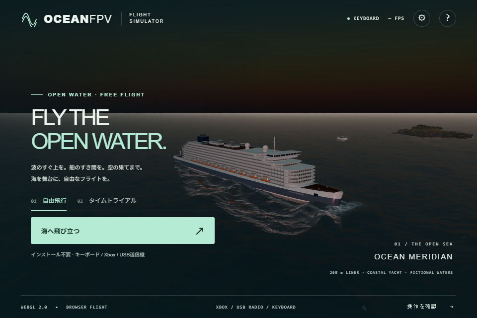
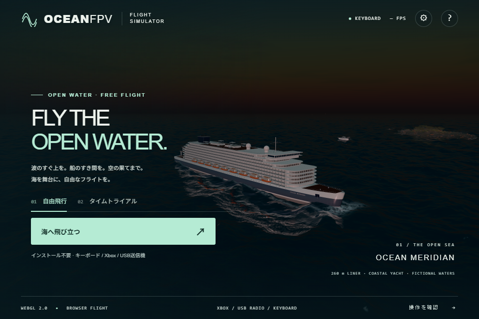

# Sky-matched ocean haze

The ocean previously faded toward fixed blue/brown radiance with distance. That produced a bright horizontal band against the dark BLUE sky. Following the aerial-perspective approach in [web-ocean](https://github.com/Noniv/web-ocean/tree/a07c7fd522ef0a897601c114f927a49d93d95520), the sea now fades toward the horizon in the viewing direction.

The colour comes from the sharpest available PMREM level, reusing the existing environment sampler, background rotation and background intensity. The environment's diffuse-light intensity is deliberately independent. The existing distance transmission `exp(-distance*0.0001)` and the no-environment colour fallback are retained. This adapts the directional horizon colour; it does not port the reference's atmosphere LUT or wavelength-dependent extinction.

## Unmodified minified comparison

These are unedited BLUE screenshots from the preceding public build and the new minified build, with the same saved settings, initial camera, 960×640 viewport and 1920×1280 ULTRA scene framebuffer. An observer opens the real settings dialog before the first game animation callback, asserted to be zero, and only its overlay is hidden.

Before:

After:

Separate DAY/GOLDEN/BLUE prototype comparisons cover two views each. Time, camera matrix, three displacement-field hashes and sun direction are identical within every pair. The shader change does not alter waves, vessel motion or contacts.

## Verification and limits

- The production GLSL passes 129 GPU numerical cases on native Direct3D11 and SwiftShader: directional sky colour, three background rotations, background/diffuse intensity separation, distance blending, a vertical view, legacy fallback and an actual constant PMREM texture. Maximum analytical error is 1.35e-7; constant-PMREM errors are below 3.4e-8. Thresholds remain 1e-5 and 3e-4 respectively.
- The complete native scene still uses 16 water texture samplers against a 16-sampler limit and has no WebGL errors. No new textures or sampler slots are added.
- The minified ULTRA build passes keyboard flight, pause/resume/reset and real pointer-lock mouse input, exercising 37 asset responses across photographed light changes without errors. The separate initial BLUE capture uses all 35 non-HDR assets and reports no errors.
- The prefiltered horizon approximates the visible background; this is not a full atmospheric-scattering or volumetric-fog model. The change adds a sharp environment lookup per ocean fragment; broad hardware performance and physical-controller acceptance remain unverified.
