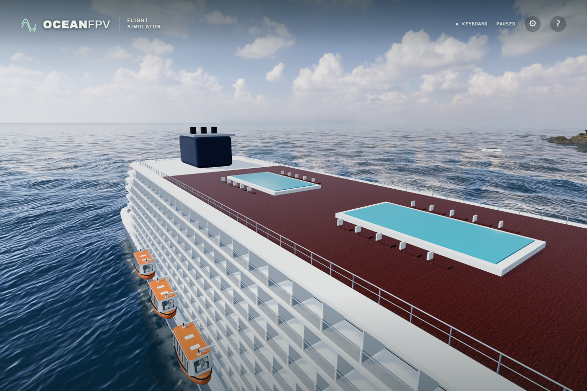
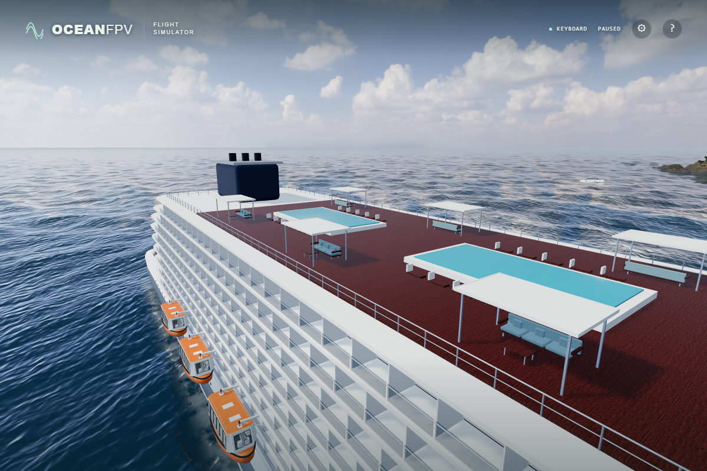
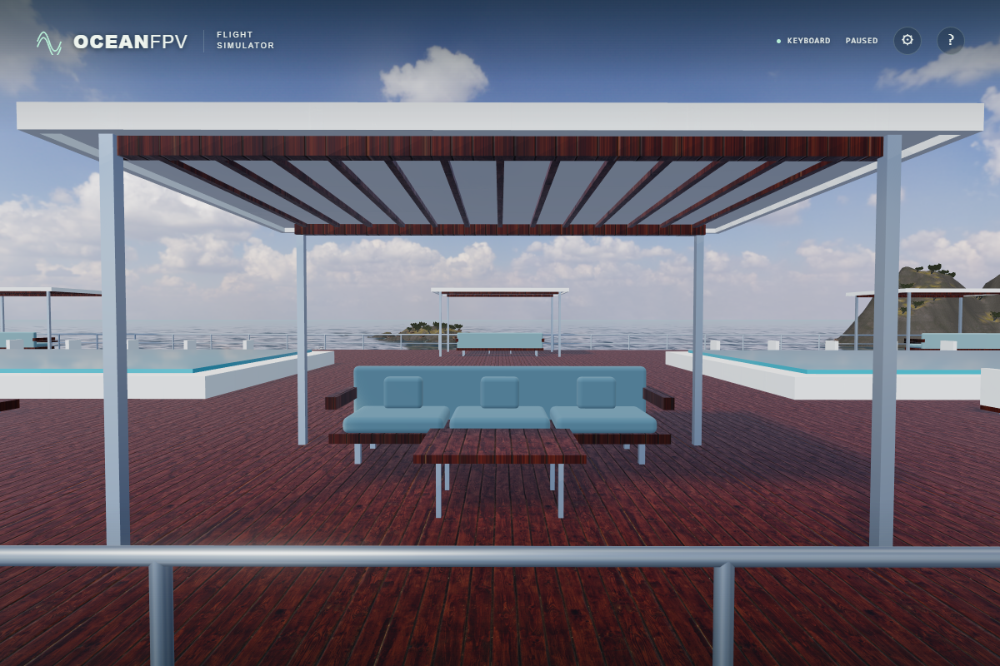

# Sea-facing pool-deck seating

Six original shaded seating bays give the previously sparse pool deck supported roofs, furniture and usable open space. The general ocean-facing arrangement is informed by [Celebrity's official Resort Deck description](https://www.celebritycruises.com/ca/cruise-ships/celebrity-edge/onboard-experience/resort-deck). No external model, photograph or branding is included.

Before:

After:

The before/after captures are unprocessed native ULTRA frames at identical time 0, ship transform and camera. Both the elevated view and the opening were also compared under the golden lighting preset. Images demonstrate added structure and depth; the flat pool water and the broader realism target still need improvement.

Each bay has four supported columns, a thin canopy with timber underside framing, a three-cushion sofa and a low table. All 72 column/furniture feet land on the existing timber floor. The perimeter aisle and the space below the roof remain open to flight. Contacts follow individual components, with conservative box bounds for rounded cushions and the existing 0.2 m drone clearance. Finite swept contacts catch narrow columns without extending the path beyond its endpoint. The upholstery has its own material, so it remains visible at balanced quality as well as ULTRA.

Verification: all 159 unit tests, the strict TypeScript/Vite build and the byte-identical cabin atlas check pass. Two native browser cases verify the existing deck guards and all six actual rendered cabanas, including roof/seat contacts, high-speed column crossings and clear openings/aisles. Minified native ULTRA passes at 1,920 × 1,280 with 36 photographic asset responses and no unexpected errors. The suite contains 33 browser cases; the entire suite was not rerun locally for this addition.

Production: `index-BU-ZV2OB.js`, SHA-256 `a34210d6a0e0b3b13fdcdfd57ee58aea62269dd93f98c9adde2e0eb4fe0cf81c`. Public deployment and physical-controller acceptance remain separate checks.
