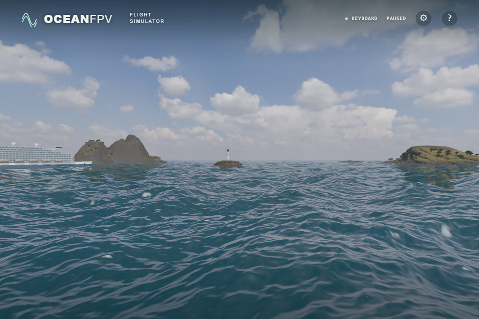
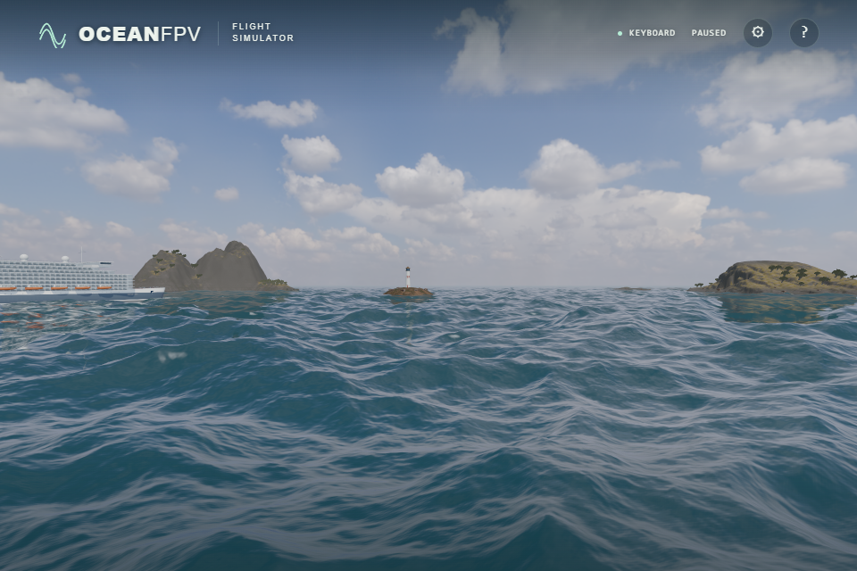

# Shared wind-sea and swell spectrum

Wind waves now use the fetch-limited JONSWAP density and frequency-dependent
Donelan directional spreading adapted from
[web-ocean](https://github.com/Noniv/web-ocean/tree/a07c7fd522ef0a897601c114f927a49d93d95520),
under the [retained MIT notice](../public/licenses/web-ocean.txt). An independent
120 m swell peak crosses the wind sea. This replaces the earlier separate
Phillips/RMS normalization of each wavelength band.

## Energy shared across bands

The three existing 128² fields retain their 433/97/23.3 m tiles and
36–433 / 4–36 / 0.45–4 m wavelength ranges. They sample one continuous physical
wave-vector density, including `dω/dk / k` and each grid's `Δk²` cell area. No
band is independently amplified to a requested RMS. The packed IFFT, geometric
derivatives, displaced contact inversion, compression cap, filtering and foam
all continue to use these shared fields.

The base wind is 11 m/s over 150 km at direction 0.7 radians. The crossing swell
has significant height 2.5 m, peak wavelength 120 m and direction −0.45 radians.
Its normalized `cos⁸(θ/2)` spread is broader than the reference's narrow swell,
because a 120 m peak on a 433 m tile has few frequency modes. The 1.2 mm short
wave damping follows the reference. The existing authored preset gains remain;
the game presets do not represent calibrated weather observations.

The raw-grid ensemble variance is approximately `[0.8207, 0.0945, 0.001284] m²`,
giving total RMS 0.9573 m, about 4.1% above the previous independently authored
0.9194 m. Short-band variance is about 82% lower. Actual seeded variance changes
with phase and interpolation; these expectations are not measurements of an
individual screenshot. The visible result has less small-scale crumpling while
retaining large rolling waves.

Our positive-time/positive-IFFT convention makes `h0(k)` travel toward `−k`.
Physical travel-direction density is therefore evaluated at `(-kx,-kz)`. Numeric
RMS callers retain the legacy Phillips behavior for compatibility.

## Verification

All 189 unit tests and the strict production build pass. Five new physical
checks cover normalized Donelan spreading, analytic Pierson–Moskowitz variance
when gamma is one, the frequency-to-wave-vector Jacobian and swell height,
actual wave travel direction, and absolute single-Fourier-pair energy over
three FFT sizes and two tile lengths. The latter uses independent fixed
seeded/Parseval expectations, so a missing `Δk²` or incorrect IFFT scale fails.

Existing contact, compression, cadence and reset checks pass. Historical tests
that required a fixed quantity of white foam from the old amplified short band
now require actual rough-versus-calm response, independent wind suppression and
unchanged reset behavior. They do not guarantee a minimum visible foam area.

Native production scene checks pass at the existing 16/16 sampler limit. GPU
coastal depth, 616 optical paths, 324 water-radiance cases and slope-moment
checks retain their thresholds. The whitecap filter fixture uses explicit
uniform `[3,3,3]` storm forcing on the real new spectral fields to exercise
fresh/residual coverage. All 576/288 cases and the original error/aged-coverage
thresholds pass on native Direct3D11 and SwiftShader; game presets retain their
own forcing. Native maximum quadrature/dense/manual errors are
`5.41e-8 / 0.000255 / 0.0000436`; 1,412 aged texels exercise the residual path.

Twelve native ULTRA screenshots compare the unchanged pre-spectrum source
against this version at exact simulation time zero, identical camera, FOV65 and
DAY/GOLDEN settings. Both were started and paused in one browser task. Wave
fields intentionally differ. These are raw screenshots; the 1920×1280 drawing
buffer is presented through a 960×640 viewport.

| Earlier separately normalized bands | Shared physical density |
| --- | --- |
|  |  |

The reference's six-cascade WebGPU solver, finer wave bands and combined
world-space foam history remain unported. No sustained performance or physical
controller acceptance is inferred from these checks. CI and public acceptance
are separate checks.
