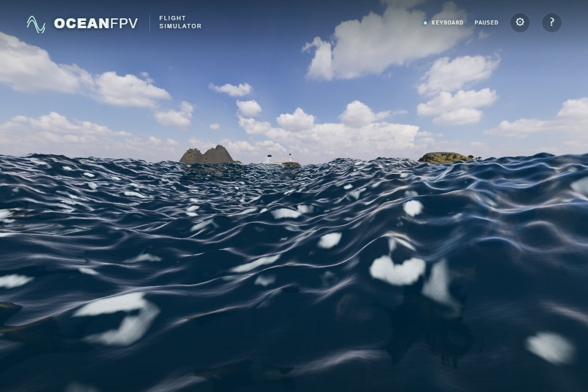
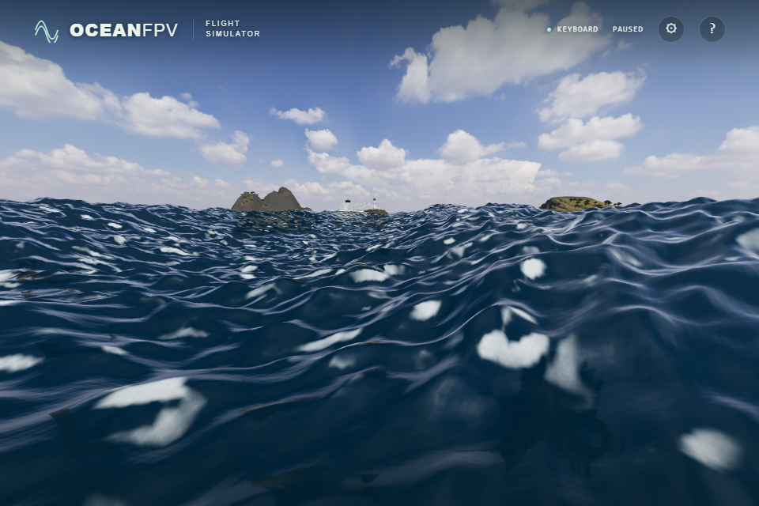
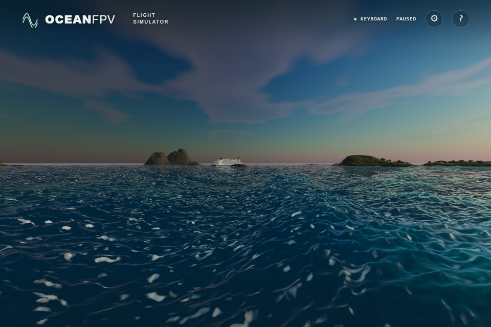
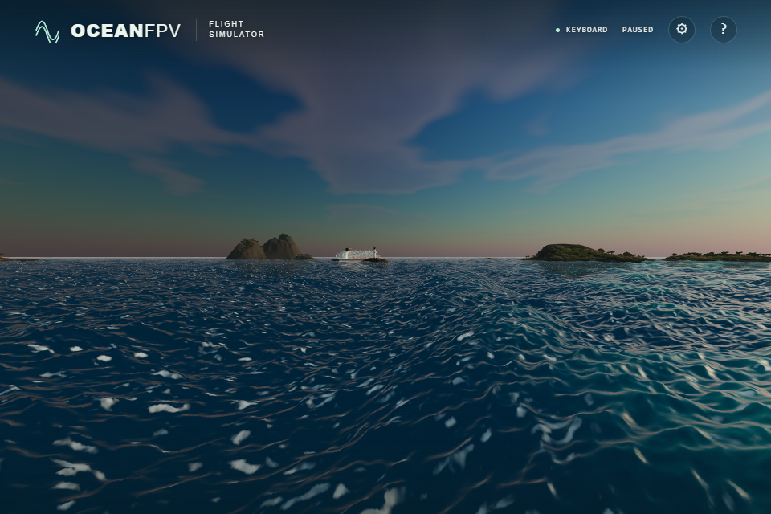

# Directional sky reflections on waves

The water previously projected one planar image containing both objects and sky, then displaced its screen coordinates by an empirical normal offset. It now samples the existing sky PMREM along `reflect(-view,normal)`. Its roughness uses the existing unresolved FFT/ripple variance and normal footprint; no second wind spectrum or additional texture sampler is introduced. Three.js documents the roughness-dependent environment filtering in [PMREMGenerator](https://threejs.org/docs/pages/PMREMGenerator.html).

The reflected sky uses the visible background's intensity and inverse rotation. Photographic daylight has background intensity 1 and material-environment intensity 0.6; reusing the latter would incorrectly darken the sky reflection. The existing environment continues to light foam and vessel materials independently.

Objects retain the planar reflection, captured against transparent black. Its RGB is already weighted by coverage, so composition is `objectRGB + skyRGB * (1 - alpha)`. Coordinates outside the planar image use the sky rather than stretching its edge. Only actual clear operations use transparent black; the renderer's logical clear state remains intact across nested reflection and transmission passes. Methods, background and clear state are restored after successful draws and exceptions.

Before:

After:

Before:

After:

These unprocessed native ULTRA images are part of 18 matched before/after pairs at 1,920 × 1,280. DAY/GOLDEN/BLUE cover six camera poses: low water, grazing, elevated, ship, alongside glazing and pool deck. Each pair retains identical camera, time 120, all displacement bytes, vessel transform, sun, light rotations/intensities and framebuffer. The restored old daylight renders are byte-identical to four captures made before the implementation. The visible change is modest; foam shapes and the coastal silhouette still need work.

Verification: 172 unit tests, strict TypeScript/Vite build and the unchanged cabin atlas pass. Four new state tests cover normal draws, nesting, transmission clears and failures. The production reflection helper passes 165 analytical GPU cases on native Direct3D11 and SwiftShader, with maximum error 0.000000123. A real translucent material recomposes within 0.000000020. A real Reflector nested inside physical-glass transmission preserves the exact renderer state. Related 54 sun, 70 foam-lighting and 4,035 wake cases pass on both backends. The full native scene compiles the actual PMREM with 15 fragment samplers against the device limit of 16 and reports no missing surfaces or browser errors.

The environment remains a GGX prefilter approximation. Planar object distortion, isotropic slope statistics, wave occlusion and a single alpha channel are limitations. Three.js physical transmission alpha omits the Fresnel term: the neutral-glass test differs from a solid-background reference by at most 0.022913 in linear RGB; colored attenuation is not exact. This change does not implement ray-traced reflections or change wave geometry, contacts or foam coverage. Public deployment and physical-controller acceptance remain separate checks.
