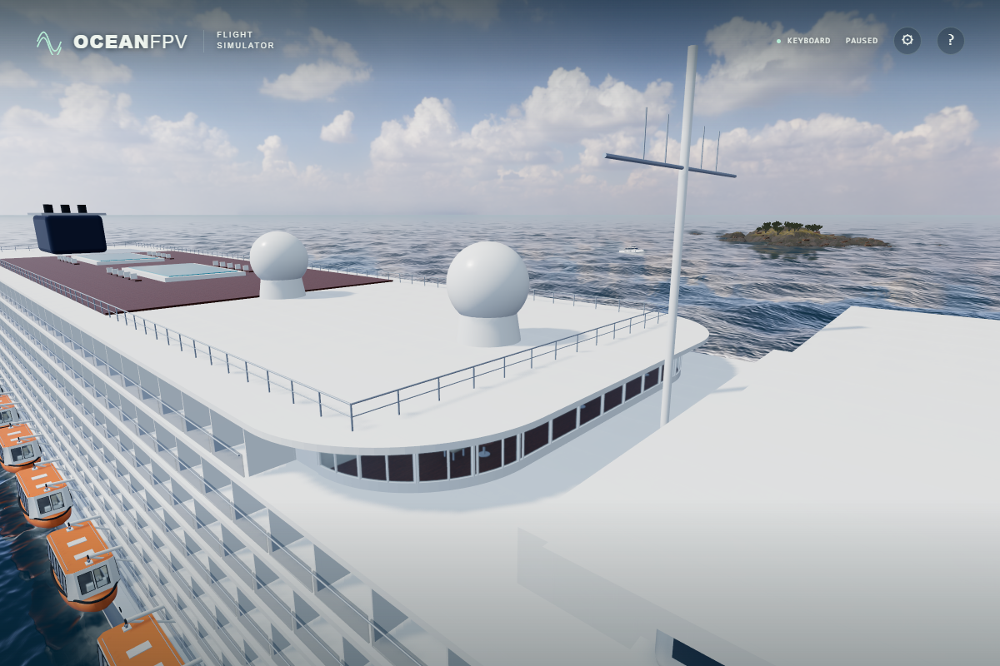

# Closed sun-deck guards

The upper sun-deck rails previously stopped at the bow and stern. Close both ends and use the same finite rod segments for rendering and drone contacts, including movement between physics positions.

Before:

After:

These are unprocessed native RTX 4050 ULTRA captures at the same paused time (0), ship transform and camera. The aft comparison was also captured and inspected at a matching camera and transform.

The perimeter has two horizontal bars at 0.55 m and 1.05 m above the deck, with posts no more than 2.2 m apart. Tests raycast each post onto the actual rounded deck. Contacts use each rod's radius plus the existing 0.2 m drone clearance; they do not fill the railing with an invisible wall. Finite swept contacts catch crossings whose endpoints both lie outside a rod, without extending the flight path beyond its endpoint. Existing lower stern rails retain their geometry.

Verification:

- All 156 unit tests pass, including closed corners, supported posts, grazing clearance, all four swept directions, and clear air above, between and inside the rails. The strict TypeScript/Vite build passes.
- Native browser tests raycast the four visible guards and check their actual world contacts, fast crossings and clear air. This case and the moving-vessel/launch/recovery case both pass.
- `npm run check:cabin` confirms the cabin atlas bytes and input fingerprint remain unchanged.
- Minified native ULTRA renders at 1,920 × 1,280 with 36 photographic asset responses and no unexpected errors. The browser suite lists 32 cases; the entire suite was not rerun locally for this change.

Production bundle: `index-DhAavnfh.js`, SHA-256 `cb1a141e29972f6c141a347973e5fbb0032b745beda95ba658567afab92ad097`. Public deployment and physical-controller acceptance remain separate checks.
