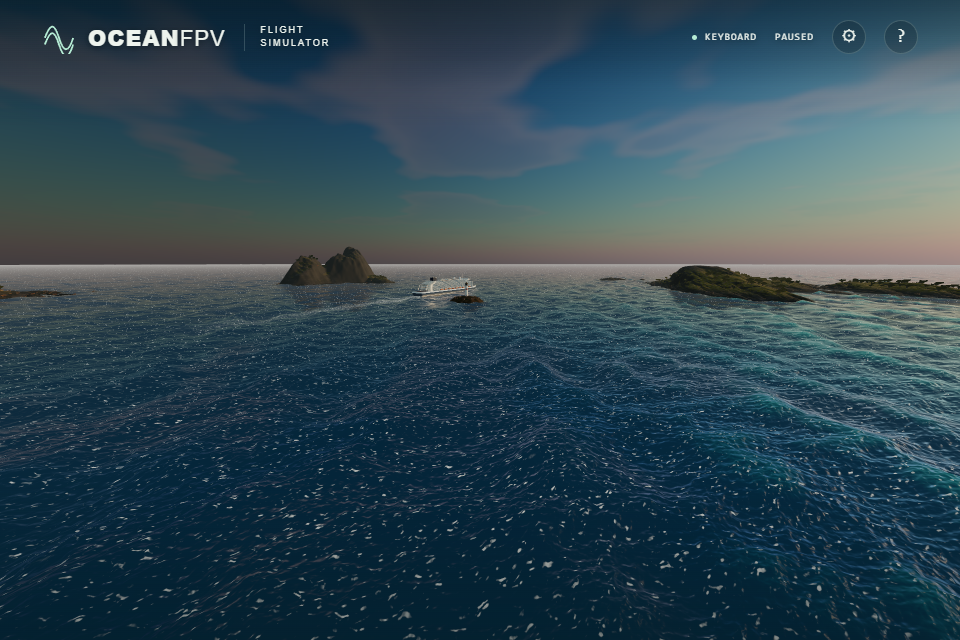
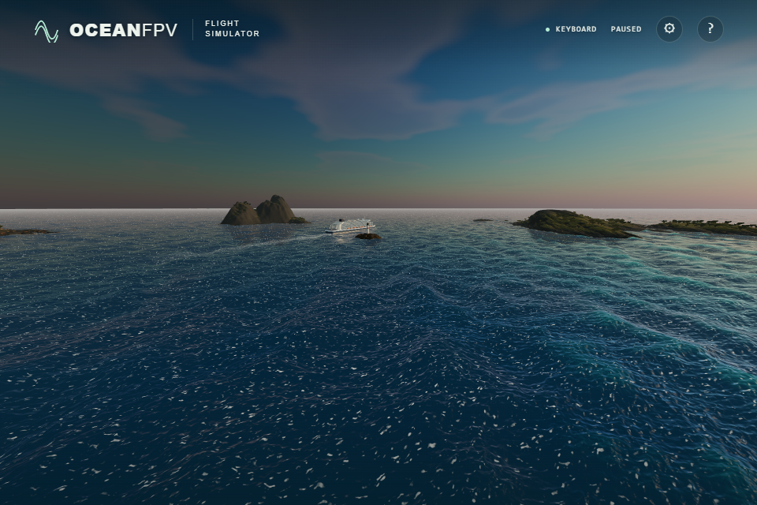

# Direct sunlight on the ocean

The ocean used the surface-to-view angle for both sky reflection and direct sunlight. A GGX microfacet reflects direct light using the view-to-half-vector angle instead. Direct sunlight now uses that angle; the sky keeps its existing surface angle. This follows the angle contract in the installed Three.js `BRDF_GGX` implementation.

The correction can increase or decrease a highlight depending on its angles. With a horizontal surface, eye/sun elevations of 5°/46° previously multiplied the direct-light Fresnel term by 8.11; at 35°/9° the old term was only 0.30 of the corrected value. The mirror peak retains the same reflectance.

The GPU regression executes the actual production reflection and glint blocks into a floating-point target. Six view/light pairs, three normals and three unresolved variances give 54 cases, compared with an independent double-precision Schlick calculation. The old shader fails numerically rather than through a shader or fixture error.

| Renderer | Maximum direct-light Fresnel error |
| --- | ---: |
| Old shader, RTX 4050 / Direct3D11 | 0.57558946 |
| Corrected shader, RTX 4050 / Direct3D11 | 0.0000000831 |
| Corrected shader, SwiftShader | 0.0000002456 |

Sky reflectance, normal invariance of the direct-light term and agreement at the mirror peak also pass the 0.000002 tolerance on both renderers.

Sixteen matched native ULTRA screenshots cover daylight/golden light, BREEZE/SWELL and near/grazing/elevated/sunward views. Camera, FOV 95, wave/vessel time 120, all spectral displacement bytes, vessel transform, sun and 1,920 × 1,280 framebuffer are identical. Screenshots retain the browser's 960 × 640 viewport output without image editing.

Before:

After:

These differences are subtle. In this elevated golden view, the bottom 45% changes by a mean 0.254 RGB levels out of 255; 7.69% of pixels change by more than one level. The other views were also compared without changing exposure, foam, wave shape or reflected sky. Four additional matched views with only the production direct-glint term suppressed have byte-identical before/after PNGs. This isolates the change to direct sunlight.

The broad white reflection patterns remain a separate realism limitation. This correction does not claim a redesigned sea appearance. Verification also passes 168 unit tests, the strict TypeScript/Vite build and the unchanged cabin-atlas check. The browser suite now contains 35 cases; only the new GPU case was rerun on both renderers for this change.

Production bundle: `index-DSemb7bx.js`, SHA-256 `9a942751a6aac1d95480e0b3ec44ebce98c4b9856074fe1a537c8e1c8e4574cf`. Public deployment and physical-controller acceptance remain separate checks.
