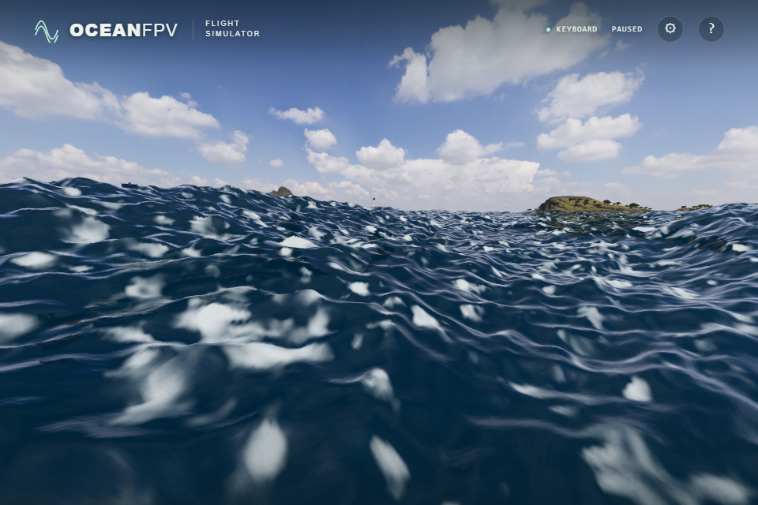
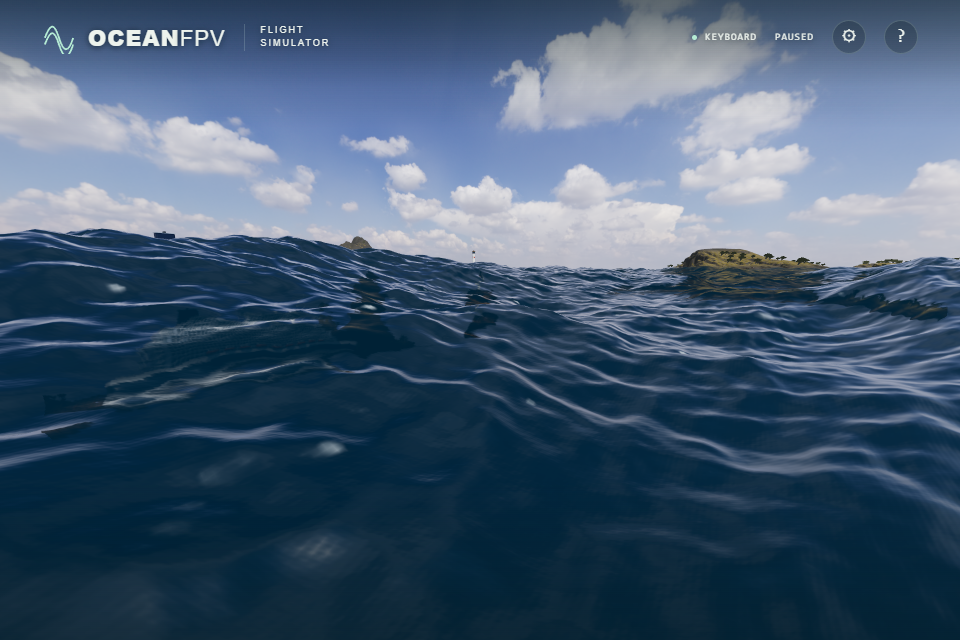

# Swell and local wind waves

SWELL previously multiplied all three FFT bands by 2.15. This raised the short
0.45–4 m waves together with the longer swell, generating persistent, dense white
patches in ordinary play. A normal ten-second native-GPU run confirmed the
problem; a single jump to a frozen time does not reproduce the same foam history.

The new profile retains the 2.15 height gain for the 36–433 m and 4–36 m bands,
while the short band uses BREEZE's 1.15 gain. The smaller shader ripples follow
that short-band gain. CALM and BREEZE retain their existing gains. This is an
authored sea preset, not a calibrated wind-speed or significant-wave-height
forecast. The distinction follows the NWS definitions of [local wind
waves](https://forecast.weather.gov/glossary.php?word=wind+waves) and
[swell](https://forecast.weather.gov/glossary.php?word=swell).

All bands share one compression limit before horizontal displacement can invert
the combined surface. Reducing the short-band contribution changes that shared
limit, so horizontal displacement and vessel pose can change even though the
longer bands retain their height. GPU displacement, tangents and coastal height
gradients, CPU inverse mapping and contacts use the same per-band gains. Missing
slope/height energy and adjacent-mip covariance use each band's squared height
gain. A requested profile change invalidates vessel pose/launch velocity caches
and clears coupled foam histories; ordinary limiter motion does not clear them.

An eight-second accumulated 1/120 s unit simulation verifies unchanged raw FFT
XYZ/tangents, retained long-band gains and substantially less short-band foam.
The native GPU probe covers 6,832 coastal displacement, normal and unresolved
variance samples, including 1,708 unequal-profile samples. With the final preset,
maximum CPU/GPU contact error is 2.53 mm. Both normal and forced manual float
filtering pass the existing whitecap footprint checks without relaxed limits.
The renderer integration also passes the related SwiftShader cases and actual
moving-deck launch/profile-cache checks.

These raw screenshots show the actual game after starting normally and running
to simulation time 10.0083333333 s, with spectral time 9.9916666667 s. The normal
help dialog freezes the scene, then the same camera is placed two metres above
the water. There are no time jumps, field replacements or shader overrides.
Vessel pose is allowed to follow the changed sea. Screenshots are unprocessed.

| Before | After |
| --- | --- |
|  |  |

The minified build passes keyboard climb, pause/resume/reset, light settings,
real pointer lock/mouse input and ULTRA 1920 × 1280 rendering with thirty-six
successful asset responses and no console/WebGL errors. Full remote CI and
public deployment are separate acceptance steps. Physical Xbox/USB transmitter
acceptance, sustained-flight performance and further foam-shape/transport,
reflection and coastal realism work remain open.

Production bundle: `index-C28xksFz.js`, SHA-256
`136abcdf47048b76d934f27883c59c111f40c8bdefe2ffe7c21d1fe7985e538a`.
