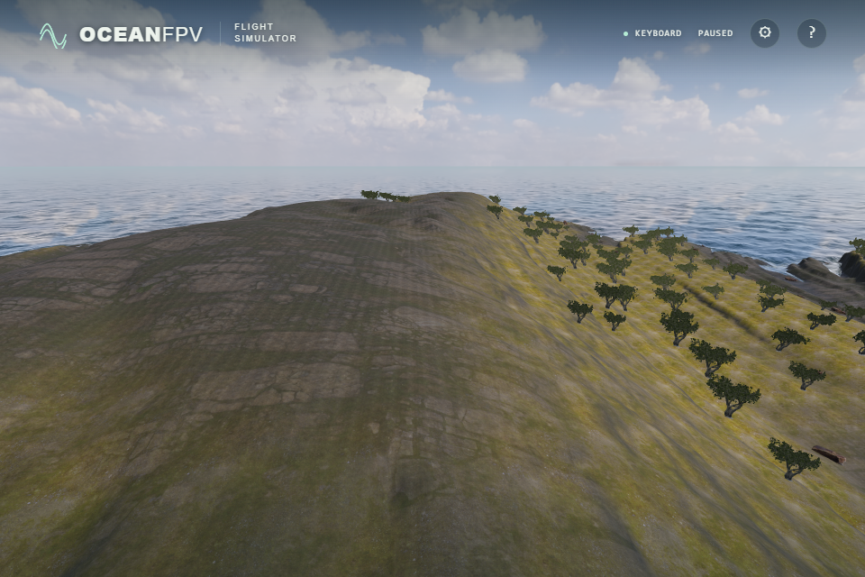

# Coastal fine detail

The photographed 2 m rock detail formerly repeated at identical phases across large ground surfaces. At a low viewing angle its normals formed regular corrugated bands. Fine colour, roughness and normal maps now share deterministic per-cell offsets with a smooth crossfade. Local texture scale and the original tangent frames are retained; explicit gradients prevent phase changes from choosing incorrect mip levels.

The change applies when all three fine maps are available. Incomplete assets retain the existing macro/grass material, and restoring the assets restores the complete material. The 90 m macro colour, 15 m grass, captured boulders and underwater texture are separate. Large photographed slab patterns remain visible; this change addresses fine repetition rather than completing the terrain's appearance.

The design draws on [Unity Labs' stochastic texturing research](https://unity.com/blog/engine-platform/procedural-stochastic-texturing-in-unity) and [Mikkelsen's Practical Real-Time Hex-Tiling](https://jcgt.org/published/0011/03/05/paper-lowres.pdf). This implementation uses four axis-aligned offsets, with no texture rotation or histogram transform. It does not implement either paper's complete method. Where a crossfade weight is zero, the unused texture reads are skipped.

## Verification

- Native RTX4050/D3D11 and SwiftShader pass 96 projection cases, 2,592 detail/fallback/restored cases, and 20 signed-cell, exact integer-hash and known-mip cases. Expected values use independent integer arithmetic and analytical tangent frames. Restored output must match complete output within 0.000002. Existing numerical tolerances are retained.
- The native scene, partial texture failure and keyboard flight checks pass, as do all 136 unit tests and the strict build. Actual ground/water shaders use 10/14 samplers against a limit of 16.
- Six actual renderer captures cover three cameras in daylight/evening, with no missing materials or browser errors. The comparison below fixes the same detailed geometry, camera (640,85,-700) looking at (650,30,-900), FOV65, wave/vessel time120 and ULTRA 1920×1280 buffer. Exported images are 960×640. The original and final implementations are captured independently.

## Native GPU cost

These are GPU timer measurements of forced paused frames, from first draw to final submission, including the full scene and water reflection. Each run uses eight warmup frames and 24 samples. They do not measure complete gameplay frame time or establish performance on other hardware.

| ULTRA view | Former fine tiling median | Four-sample phase median | Final phase median, two runs |
| --- | ---: | ---: | ---: |
| Overlook | 15.87 ms | 24.22 ms | 18.69–19.53 ms |
| Coast | 10.30 ms | 12.79 ms | 12.15–12.58 ms |

The first final run had two large samples (43.55 and 79.68 ms). Its overlook p95 was 43.55 ms; the repeated run had a p95 of 21.33 ms. The data do not establish the cause of those two waits or sustained performance. BALANCED medians in a separate run were 9.15 ms overlooking the ground and 4.27 ms near the coast. Long sessions, other GPUs and physical controller acceptance remain separate checks.

Former fine tiling, with the same detailed terrain:

Final fine phase sampling:

