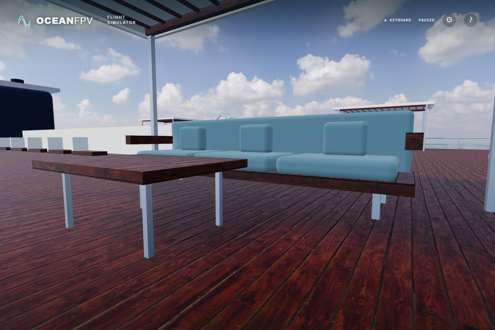

# Wood grain on vertical vessel surfaces

The cruise liner and coastal yacht previously projected every timber face onto the horizontal X/Z plane. This collapsed the image to a line on vertical furniture, table edges and canopy framing. Both builders now use the existing triangle projection at the same 1.8 m period; horizontal deck charts retain their previous coordinates.

Before:

After:

These unprocessed native ULTRA frames use identical daylight, time 0, ship transform and camera. The furniture detail and complete shaded bay were also compared under golden lighting, for eight matched captures in total.

An audit of the actual merged timber meshes found 39,092 collapsed triangles out of 60,616 on the cruise liner, and 56 out of 3,104 on the yacht. Neither model has collapsed timber charts after the correction. Two tests check a geometric lower bound on projected area rather than duplicating the projection's axis choices, and verify unchanged horizontal coordinates.

All rendered positions, normals, ambient-occlusion UV1 coordinates and contact boxes retain the same combined digest. All 393,216 cabin-atlas bytes remain identical. The generated input fingerprint changes because the timber blockers are expanded from indexed to non-indexed geometry; the visibility data itself does not change.

Verification: 167 unit tests, the strict TypeScript/Vite build, the byte-identical cabin-atlas check and minified native ULTRA at 1,920 × 1,280 pass, with 36 photographic asset responses and no unexpected errors. The projection keeps the existing texture and colour. Material ageing, the strong red hue and chart seams on curved furniture are separate remaining limitations; this correction does not claim continuous cylindrical wood grain.

Production bundle (unchanged by the later test-fixture integration): `index-hJilH_3-.js`, SHA-256 `d13bdcc9bdecd8bae49c22cf17cf6e07a67eb4d742ac062fee525fe431c0555e`. Public deployment and physical-controller acceptance remain separate checks.
