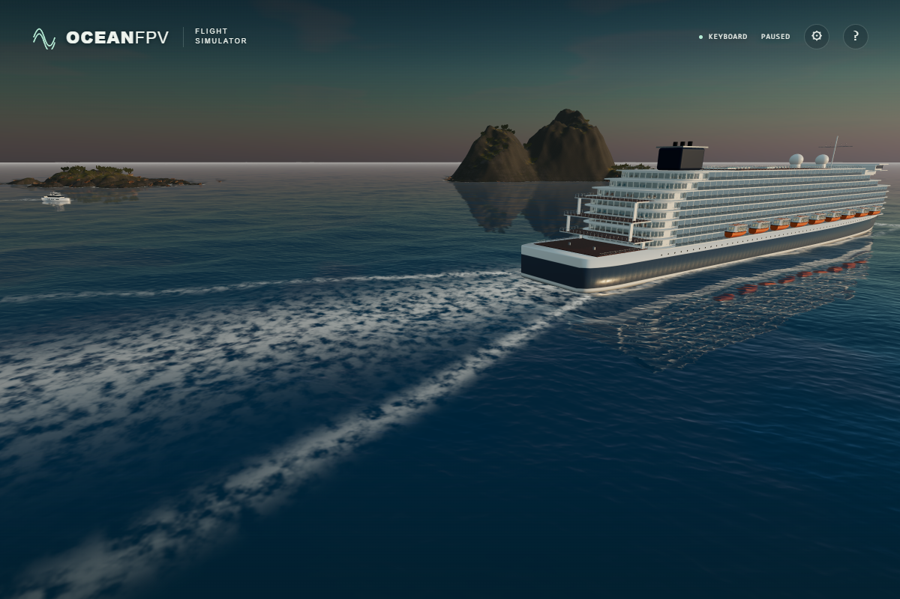

# Wake reflection direction

The old wake perturbed the water normal along a fixed world-space vector. It could not mirror the transverse slope on opposite sides of the V-shaped wake or rotate that slope with the vessel.

The shader now differentiates the complete Kelvin detail: its oscillation, spreading crest envelope, distance decay and launch fade. The local gradient rotates back into world space before modifying the ocean normal. The 3.5 cm detail is a normal effect, separate from the geometric spectral waves and flight-contact height.

Vessel directions arrive as CPU-computed cosine/sine pairs. In the first software-GPU probe, evaluating the heading's trigonometric functions in the shader displaced the transformed stern coordinate by 7.4 mm. Passing the direction directly fixes this error without increasing the original normal-error limit.

The analytic-height-gradient approach follows the normals-and-tangents derivation in [NVIDIA GPU Gems, chapter 1](https://developer.nvidia.com/gpugems/gpugems/part-i-natural-effects/chapter-1-effective-water-simulation-physical-models).

This raw native image uses golden-hour lighting and calm seas. The simulator advanced normally to 35.025 s, then paused. Matched previous/current shader captures held the world, camera, foam, geometry, lighting and CPU directions fixed. The visual difference is subtle where white foam covers the reflection; this is a directional-correctness repair, not a large change to the overall sea appearance.

Verification:

- 4,035 GPU samples cover both vessel dimensions, both wake sides, four headings, four speeds, three times and the launch fade. An independent scalar height function supplies central-difference reference normals. Maximum component errors are 0.000001302 on native Direct3D11 and 0.000009553 on SwiftShader, below the unchanged 0.00005 limit. Mirror and 90-degree rotation errors are zero.
- All 142 unit tests and the strict TypeScript/Vite build pass. Native full-scene checks confirm complete photographic materials, CPU direction uploads, no browser/shader errors and 14 water samplers against a 16-sampler limit.
- The minified production build passes native ULTRA at 1,920 x 1,280 with 36 asset responses and no errors. Bundle: `index-BBQXIUQV.js`; SHA256: `c2532dcbbb765500d45e26fb70b9e9924dc936ef87be18a27a0016e946bdb7e0`.

These are local rendering checks; public deployment and physical-controller acceptance require their own verification.
