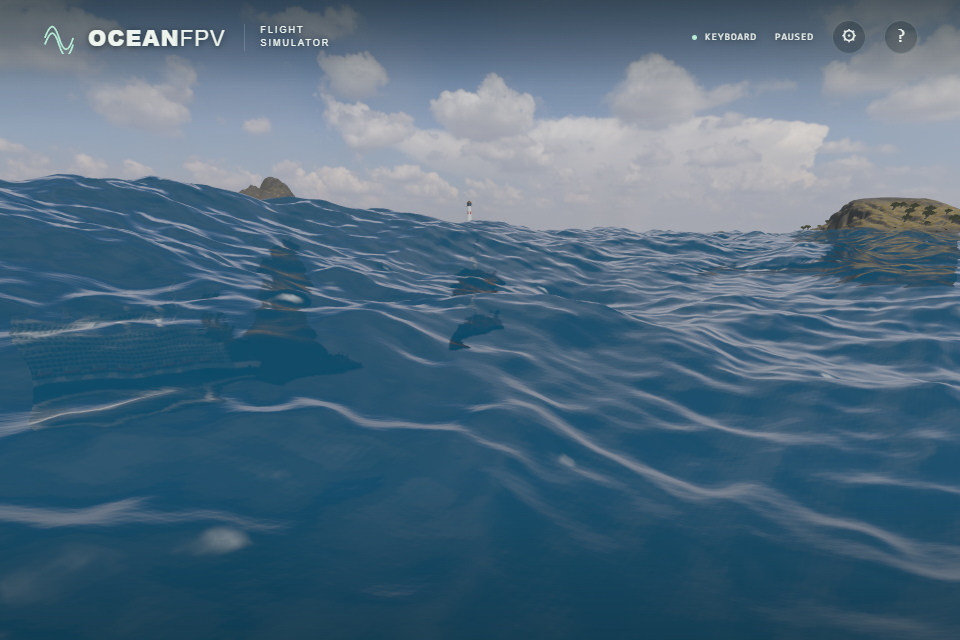
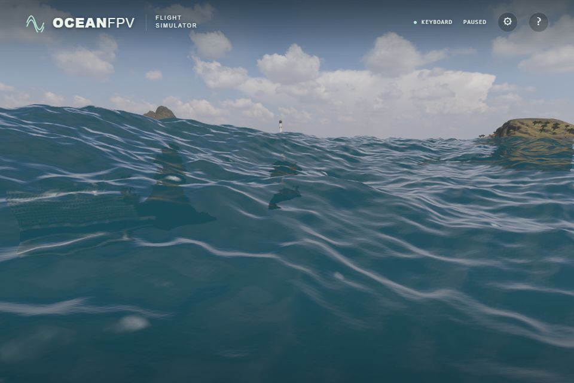

# web-ocean rendering comparison

Reviewed 2026-10-17 against [Noniv/web-ocean](https://github.com/Noniv/web-ocean/tree/a07c7fd522ef0a897601c114f927a49d93d95520), commit `a07c7fd522ef0a897601c114f927a49d93d95520`. Its MIT notice is retained in [the shipped license](../public/licenses/web-ocean.txt). The reference was run locally in full Chromium with native NVIDIA WebGPU, including its unmodified screenshot hook at a fixed 240 simulation frames. This is a rendering precedent, not a claim that the two games have equivalent features or performance.

## Adopted

- **AgX output:** Three.js's AgX tone mapper replaces ACES while retaining DAY/GOLDEN/BLUE exposures of 0.68/0.70/0.58. Matched native captures showed less saturated blue and softer bright reflection edges. A 1.35× exposure candidate washed out the scene and was rejected. OceanFPV retains its existing bloom settings.
- **Smoothly illuminated upwelling:** deep-water colour now follows the average water surface's incident diffuse light, using the existing PMREM, hemisphere and directional lighting. It no longer emits a fixed blue radiance in darkness. Optical depth, refracted path lengths, shelf confidence and sea-floor transmission are retained. This adds one PMREM lookup, without another sampler binding.
- **Coastal chromaticity:** the reference's default water colour has RGB ratio 1:5:6. Directly copying its magnitude made this scene too bright. OceanFPV uses `(0.00933, 0.04665, 0.05598)` in linear space, approximately retaining the original albedo's photopic luminance. The result reduces the old blue bias without brightening the entire ocean. This is an authored scatter proxy, not measured volumetric water optics.

The colour comparison below holds illumination, AgX, camera, FOV65, actual ten-second simulation state, vessel pose and all three displacement-field hashes identical within each pair. These are raw browser screenshots at ULTRA (1920×1280 drawing buffer), displayed by a 960×640 viewport. There is no image processing.

| Existing blue albedo | Adapted coastal chromaticity |
| --- | --- |
|  |  |

## Examined, not yet adopted

- World-space foam histories driven by the **combined** horizontal displacement Jacobian, with separate fresh and residual foam. OceanFPV's current persistent foam remains a per-cascade approximation. A far history must integrate the thresholded breaking signal over its cells; sampling sub-metre waves on a two-metre grid can produce wholly missing or excessive foam.
- Local slope covariance mipmaps and anisotropic sun glints. The current shader has 15 active sampler bindings on a native limit of 16; adding independent history, moments and bubble textures requires packing or sharing resources.
- Spatial wind gusts for the shortest ripples. A matched prototype had only a small visible effect and is not shipped.
- The reference's WebGPU FFT, spectrum, atmosphere and entire postprocessing pipeline. OceanFPV retains its shared CPU FFT/render/contact fields, coastal depth, moving ships, controls and WebGL2 support.

## Verification

At the initial lighting port: all 179 unit tests and the strict production build passed. Native Direct3D11 checks passed for detailed coastal depth/optics, environment reflection and foam illumination. The production optical function was checked against 324 independent transmission cases and 20 additional zero/chromatic/unit/double-illumination cases, including the shelf transition and deep-water early return. The maximum new linear-radiance error was below `1.3e-8` on both native Direct3D11 and SwiftShader. The hue follow-up passed the same native depth/optics probe.

Native prototype captures covered DAY/GOLDEN close, grazing and aerial views. They establish those sampled views, not sustained frame rate or physical Xbox/FPV-radio acceptance. Final browser CI and public-deployment acceptance are separate gates.
