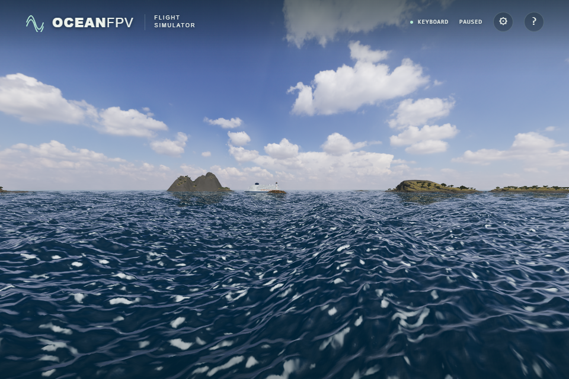

# Whitecap pixel coverage

The former whitecap expression sampled one location per ocean fragment. A small
change in the camera could move that point across a narrow patch even when the
patch covered only a fraction of the pixel. Commit `135271d` averages the final
whitecap coverage at sixteen stratified locations inside the pixel footprint on
HIGH and ULTRA. Both the undeformed wave coordinate and displaced world coordinate
use the same subpixel offset, retaining the relationship between the three wave
cascades, their maximum, the threshold and foam noise.

The point result is retained below half the shortest cascade's texel size. A
smooth transition reaches the sixteen-sample result at one texel. Derivatives
are computed before hull fragments are discarded. BALANCED retains the point
calculation. Existing floating-point interpolation and its manual fallback both
work; the water still uses fifteen active samplers on the native scene.

This follows the pixel-coverage motivation in Dupuy and Bruneton's
[Real-time Animation and Rendering of Ocean Whitecaps](https://liris.cnrs.fr/Documents/Liris-5812.pdf).
It uses explicit finite quadrature over this game's existing foam field rather
than implementing the paper's moment-based method.

## Matched production views

Before:

After:

These are unprocessed native RTX 4050 / Direct3D11 browser screenshots. The
framebuffer is ULTRA 1920 × 1280; the captured viewport is 960 × 640. The complete
comparison contains twenty-six captures: DAY/GOLDEN/BLUE, close/grazing views,
before/after, paired with foam disabled, plus a BALANCED control pair. Every pair
has identical camera, time 120, spectral field bytes and ship transform. Before
restores only the exact former point expression; after runs the production shader.
All six foam-disabled pairs and the BALANCED pair are byte-identical. The six
foam-enabled ULTRA pairs change. The visual difference is modest.

## Numerical and runtime checks

The browser fixture executes the production connection against independently
rasterized 4 × 4 and 64 × 64 samples of the former point formula. An independent
CPU bilinear sampler checks the actual Float32 wave fields, including negative
coordinates and deformed tangents. Its dense integral compares 64 × 64 with
128 × 128 and two shifted 128 × 128 grids.

Each renderer checks twelve positions and eight footprint families across three
quality levels and native/manual interpolation: 576 cases. A second test hides
float-linear support and checks the manual-only 288 cases. Both tests pass on
native Direct3D11 and SwiftShader. Footprints include resolved, transition,
square, elongated, rotated and sheared cases. Among the ninety-six reference
cases, thirty-two have zero point coverage. Maximum dense-reference convergence
error is 0.000228.

| Check | Native Direct3D11 | SwiftShader |
| --- | ---: | ---: |
| Production vs independently rasterized quadrature, maximum error | 5.61e-8 | 4.04e-8 |
| Dense GPU vs independent CPU coverage, maximum error | 0.000216 | 0.000028 |
| Manual interpolation vs CPU, maximum error | 0.000083 | 0.000083 |
| BALANCED / resolved point difference | 0 | 0 |
| Under-resolved coverage RMSE, point → filtered | 0.12185 → 0.01945 | 0.12161 → 0.01945 |

The RMSE covers the fixture's under-resolved samples, excluding the transition;
it is not a full-image quality or temporal-flicker score. Restoring the old
production expression makes quadrature error 0.35761 and leaves RMSE unchanged,
so the fixture detects the original point-sampling behavior.

The existing scene, sky-reflection, sun-glint and foam-lighting cases pass on both
renderers. The strict TypeScript/Vite build passes. The actual minified native
build also passes keyboard climb, pause/resume/reset, light settings, real pointer
lock/mouse input and ULTRA rendering with all thirty-six asset responses and no
console/WebGL errors. The browser suite now contains thirty-nine cases; the full
suite was not rerun locally for this addition. Full remote CI and public
deployment are separate acceptance steps.

Sixteen samples approximate coverage and increase HIGH/ULTRA shader work. They
do not guarantee alias-free distant or extreme grazing views. Wave geometry,
foam generation/history, patch shapes and advection are unchanged. Wake and
shore foam and the final combined clamp are not integrated by this filter.
Remaining sea-pattern and terrain realism work, sustained flight performance
and physical-controller acceptance are still open.

Production bundle: `index-C1QlhAyv.js`, SHA-256
`8c69cc2efa4cfbcf2acafdeed0ed2e5ea6bd5362c30c33a045cea66fd84d4867`.
